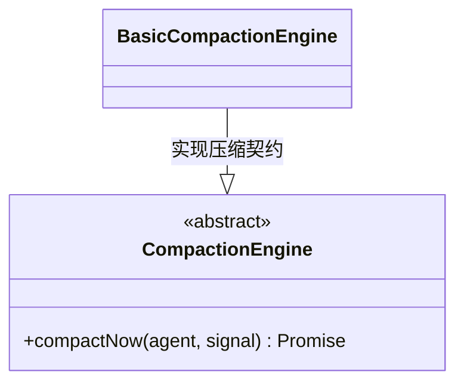

# enhance-mermaid (`ehm`) — 把代码读成图，把图上的每次点击交给宿主

> **一句话**：Agent 写增强 UML 文本，`ehm` 结合工作区目录把它物化成一张带真实代码的可交互 H5，返回一个 URL；页面上的点击 POST 给宿主，由宿主决定怎么跳。
> **产品本体不是 DSH 插件** —— DSH / Copilot 的插件都只是"宿主壳"。

## 文档索引

| 你想知道的 | 看这里 |
| --- | --- |
| **施工图**：契约、格式、端点、阶段、验收 | [IMPLEMENTATION-PLAN.md](../IMPLEMENTATION-PLAN.md) |
| **可跑的实现说明**：POC 结构、CLI、viewer API、已知限制 | [poc/README.md](./poc/README.md) |
| **DSH 双半插件**：结构、安装、验证、限制 | [dsh-ehm README](../dsh-ehm/README.md) |
| **IR 规范与校验器** | [spec/EHM-IR.md](./spec/EHM-IR.md) · [spec/validate.mjs](./spec/validate.mjs) |
| **早期架构决定（已被施工图取代，保留作 ADR 考古）** | [PLUGIN-PLAN.md](../PLUGIN-PLAN.md) |
| 39 轮需求与 14 版原型沉淀了什么 | [analysis/01-artifacts.md](../analysis/01-artifacts.md) |
| Copilot / Claude / Cursor 各自能做到什么 | [analysis/02-portability.md](../analysis/02-portability.md) |
| 第一轮自查评审（3 个 P0）+ 后续状态 | [REVIEW.md](../REVIEW.md) |
| 14 版可执行原型索引（**归档参考**） | [prototypes/README.md](../prototypes/README.md) |

## 立即可跑

```powershell
cd enhance-mermaid

# 1) 新链路冒烟（163 断言：解析 / 物化 / IR / H5 / server / facade / CLI 完整形态 / P13 约束与 skill + P14 方向，全用真实文件与真实子进程）
node poc\test\ehm.smoke.mjs
#    → 163 passed, 0 failed（133 + P13 新增 21 + P14 方向/主题/动作新增）

# 1b) 小用例验证真实布线质量（共享目标卡的边：相交/重叠/穿卡/斜线必须全 0）
node poc\tools\route-quality.mjs       # TB
node poc\tools\route-quality.mjs --lr  # LR

# 2) 增强 UML 文本 → H5，拿一个 URL（首次 render 会自动拉起后端）
node poc\bin\ehm.mjs render poc\samples\compaction.ehm.md `
     --root D:\dsh-mydsh\deepseek-harness --title "compaction 能力接缝" --json

# 3) CLI 完整形态（根 package.json name=enhance-mermaid 0.1.0，bin:{ehm:"./poc/bin/ehm.mjs"}）
node poc\bin\ehm.mjs --version          # enhance-mermaid 0.1.0
node poc\bin\ehm.mjs --help             # render / serve / validate / skill / server + 全局选项 + AI 硬约束
node poc\bin\ehm.mjs validate spec\sample.ir.json          # 校验 IR（支持 `-` stdin）
node poc\bin\ehm.mjs validate spec\sample.ir.json --json   # 机器可读
node poc\bin\ehm.mjs skill              # 输出 AI 作者指南 skills/ehm-uml/SKILL.md
node poc\bin\ehm.mjs skill --json       # {ok,path,content}

# 4) 严格模式：多 root 歧义（W_AMBIGUOUS）升级为 error E_AMBIGUOUS；仍出图/URL，但 exit 1
node poc\bin\ehm.mjs render poc\samples\compaction.ehm.md `
     --root D:\dsh-mydsh\deepseek-harness --strict --json

# 5) 后端状态 / 停止（都支持 --json；也可直接 node spec\validate.mjs <ir>）
node poc\bin\ehm.mjs server status --json
node poc\bin\ehm.mjs server stop

# 6) 可安装性自检：npm pack 清单含 skills/（P13；具体 files / 解包体积以实际输出为准）
npm pack --dry-run
#    本机安装：npm link（或 npm i -g .）后即可全局 `ehm`；也可 npm pack 出 tarball 在别处安装

# 7) DSH 双半插件离线测试（422 断言；零依赖、无需安装、不碰 live profile）
node plugin\test\run.mjs
```

### CLI 完整形态（一行速查）

| 命令 | 作用 | 关键选项 |
| --- | --- | --- |
| `ehm render <file\|->` | 生成 HTML 入口（默认外置引擎；`--bake` 才生成自包含单文件）；`--out` 默认本地模式并返回 `htmlPath`，不启 server（`--serve` 才走旧 URL/后端） | `--root`（可重复）、`--title`、`--scope`、`--strict`、`--direction`（`tb` 默认纵向 / `lr` 横向）、`--out`、`--local`、`--bake`、`--serve`、`--jump-endpoint`、`--jump-action` / `--jump-actions` / `--jump-post` / `--jump-open`、`--theme`、`--json`、`--quiet` |
| `ehm serve` | 前台运行 ehm 后端（空闲 30 min 自退） | `--port`、`--host`、`--quiet` |
| `ehm validate <ir.json\|->` | 用 `spec/validate.mjs` 校验 IR（支持 stdin） | `--json`、`--check-files`、`--selftest` |
| `ehm skill [--json]` | 输出 AI 作者指南 `skills/ehm-uml/SKILL.md`（P13；`--json` 返回 `{ok,path,content}`） | `--json`、`-h/--help` |
| `ehm server status` / `ehm server stop` | 后端状态 / 停止 | `--json` |
| `ehm --version` / `-v` · `ehm --help` / `-h` | 版本 / 帮助（6 份 help：全局 + render/serve/validate/skill/server；含 AI 硬约束） | — |

退出码：`0` 成功（非 strict 允许 warning）；`1` 渲染失败 / strict 下有 error / server 未运行 / 停止失败 / validate 有 error；`2` 用法或读取错误。
状态目录 `EHM_HOME`（默认 `~/.ehm`）：`server.json` 记录端口/pid，`docs/` 存快照。

## DSH 插件（已安装进 live profile：消息内 fence 大图 + 右侧栏 EHM tab）

`plugin/` 是同一个内核的 DSH 壳（Host 半挂 `/ehm/*` 路由 + 同源页面代理 / jump relay / `ehm_render` 工具；Client 半把图作为 **assistant 消息正文里的 fence 大图**或放进 **DSH 右侧栏 tab**），**不复制渲染器**。
**主输出 = 消息正文 `ehm` fence 大图（P12）**：Host 工具结果新增 `fence` 字段——一段可直接粘贴的 markdown：语言标记 `ehm` 的代码块，内容为单行 JSON `{ehm:1,id,htmlPath,sessionId,title,stats}`；工具 description 要求模型把 `fence` **原样放进最终回答正文**。Client 新增 **DOM fence 渲染器**：把 assistant 消息里语言为 `ehm` 的 code block 隐藏并在原位替换成 `[data-ehm-fence]` 大图——**只有一行标题** + 本地 HTML Blob iframe，高 `min(78vh, 980px)`、宽 100%、**无按钮 / 无地址栏 / 无 stats**。DSH 对未知语言只显示通用「代码块」横幅，所以 Client 用**正文自证**识别（`ehm:1` 标记；旧 fence 的 `{id,url(/e/<id>),title}` 形状向后兼容）。
**工具卡只剩一行（P12）**：`tool.call.toolview`（key=`ehm_render`）只显示标题 + stats + callId（实测 38px），**不再有 iframe / 地址 / 按钮**；大图完全由消息内 fence 承担。
**没有 EHM 主看板、没有表单、没有左栏图标入口**：右栏仍是可选的 **「EHM」tab**（chip 可见文本 `EHM`，`title`/`aria-label` 全称「EHM 结构图」），默认 `autoOpenSidebar=false` 不抢焦点。

```powershell
# 安装（本机已于 2026-11-11 在 live profile `web` 执行成功）
dsh plugin --profile web add D:/dsh-mydsh/dsh-coderef/plugin

# 热加载：P15 Host 本地渲染（CLI --local → htmlPath）是 Node 代码，需重启 DSH；Client（fence/右栏 Blob 读文件）F5 即生效
# 用法：对话里让 Agent 调 ehm_render → 工具只返回本地 htmlPath；把返回的 fence 原样贴进回答正文
#       → 消息里出现本地 HTML 的 Blob iframe（标题一行，无按钮）；右栏 tab 读同一个 htmlPath
# 刷新（F5）不再轮询 /ehm/last 或 /ehm/intent；跳转走 iframe → 父窗口 postMessage

# 卸载（DSH CLI 未加入 PATH 时用插件管理 UI；具体子命令以 `dsh plugin --help` 为准）
dsh plugin --profile web remove dsh-enhance-mermaid
```

> **安装与验证状态（2026-11-12 P15）**：已安装进 **live profile `web`**（`dsh.profile.bundles` + `cordis.patch.yml` 的 `id: ehm` config：`defaultRoots: ['D:/dsh-mydsh/deepseek-harness']`、`allowOutsideWorkspace: true`）；P15 Host 本地渲染需重启 DSH 后生效；Client 半 **F5 即加载**。旧 fence 的 URL 形状仍向后兼容（legacy `/ehm/page` 路由保留）。
> **live GUI E2E（P15 实测）**：GUI 内注入本地 fence → `[data-ehm-fence]` 大图 + `data-ehm-frame-local=1` 的 **Blob iframe** 渲染 12 卡（截图 `plugin/shots/ehm-local-fence.png`）；右栏 tab 打开 `.ehm/client-local.html` 的本地 Blob（`data-ehm-state=render`）；图内双击收到 `ehm:jump` target 并走 `sidebarRight.openResource`；全程 `ehm server status` 为「未运行」。旧的 `gui-e2e-fence` 18 项是 URL 代理链路历史证据。
> 证据：`plugin/shots/ehm-local-fence.png`、`local-fence-report.json`；离线测试 `node plugin/test/run.mjs` → **422 passed / 0 failed**。旧的 P8 主看板版已废弃；详见 [dsh-ehm README](../dsh-ehm/README.md)。

## 形态：P15 本地 HTML（默认，无 ehm serve）；legacy 三进程 HTTP 通路保留

P15 默认链路：CLI `--out`/Host `--local` 只写本地 HTML 并返回 `htmlPath`；Client 通过 DSH `workspaceFiles.readBytes` 读文件，用 sandbox Blob iframe 内联；右栏打开同一路径；没有独立 ehm server，也没有 `/ehm/last`、`/ehm/intent` 轮询。下方“三个进程 / HTTP 通路”描述的是 `--serve` 或旧 fence/旧页面使用的 **legacy served mode**，不是当前工具调用链路。

```
① Agent 宿主（长命）            ② ehm 门面（短命 / 每次调用）          ③ ehm Server（长命，一个）
  exec ──────────────────────►  ehm render
  { uml 文件或 stdin +          读输入 + 解析参数                        POST /api/render
    --root ×N +                 读 ~/.ehm/server.json 找后端；没有就       解析 mermaid + %% 指令
    --jump-endpoint }           detached 拉起 `ehm serve`               按 roots 读真实源码、抽代码
                                转发（60s 超时）                        物化 IR → 生成自包含 H5
  ◄──── stdout JSON ──────────  { url, dataPath, stats, diagnostics }  按 (scope,title) 存快照 + 落盘
    { url, dataPath, id }       首次会自动拉起后端                      静态服务；空闲 30 min 自退

④ WebView ──GET /e/<id>──► ③ ── 点击 → POST /jump/<id> ──► ③ ──POST──► ① 的 jumpEndpoint
```

**Agent 永远不碰 HTTP、不碰端口**：端口只有门面知道，Agent 只拿到一个 URL 字符串。
页面只认自己的 origin，不知道 jump endpoint 在哪；`ehm server status` / `stop` 是唯一的人工干预入口。

## 输入长什么样

一个 `.ehm.md` 文件 = **mermaid 块（结构）+ `%% ehm` 指令（数据）**：

````markdown


%% ehm:v1
%% entity CompactionEngine file=packages/compaction/compaction/src/index.ts line=96 summary="压缩抽象基类"
%% entity BasicCompactionEngine file=packages/compaction/compaction-basic/src/index.ts line=104
%% member BasicCompactionEngine.compactNow line=369
%% rel BasicCompactionEngine>CompactionEngine line=104
%% site BasicCompactionEngine>CompactionEngine file=packages/compaction/compaction-basic/src/index.ts line=104
````

指令活在 `%%` 注释里 —— **同一份文本在 GitHub / VS Code 里就是一张普通 UML 图**，没有私有语法外泄。

## 边界（硬）

| 层 | 职责 | 不做什么 |
| --- | --- | --- |
| ① Agent | 产结构、给行号、给 jumpEndpoint、决定何时重画 | 不做渲染 |
| ② 门面 | 找后端、转发、打印 JSON | 不解析 UML、不读源码、不打包 dagre |
| ③ 后端 | 解析 + 物化 + 生成 H5 + 快照 + 转发 | 不做实时刷新、不留历史、不探测 IDE |
| ④ 宿主 | 拿 H5 走 WebView，或拿 data 自己解释；收 jump 自己决定怎么跳 | — |

## 已验证 / 仍待做

**已验证**（2026-11-12 P12/P13 收口，全部为实跑输出）：

| 项 | 证据 |
| --- | --- |
| 内核全链路 | `node poc/test/ehm.smoke.mjs` → **163 passed / 0 failed**（原 133 + P13 新增 21 条：member.summary / 范围与可见性诊断 / ehm skill / framework 样板）：增强 UML 文本 → 真实源码抽取 → IR 通过 schema 校验 → H5（12 卡片 / 13 关系 / 零重叠·零穿卡·零斜线）→ server **7 个端点**（含 `/e/<id>/stale`）→ jump 真实转发 → 同 `(scope,title)` 覆盖同一 URL → 生成时间角标 → 内存 LRU 64 → 门面自动拉起 / 停止 / stdin |
| CLI 完整形态 | 根 `package.json`：name `enhance-mermaid` 0.1.0、`bin:{ehm:"./poc/bin/ehm.mjs"}`（`files` 含 `skills/`）；`ehm --version` → `enhance-mermaid 0.1.0`；`validate`（stdin/`--json`/`--check-files`/`--selftest`，退出码 0/1/2 透传）；`--strict`（歧义 W_AMBIGUOUS → E_AMBIGUOUS，仍出图但 exit 1）；`server status/stop --json`；**`ehm skill`（`--json`，输出 `skills/ehm-uml/SKILL.md`）**；`--help`/`render --help` 含 AI 硬约束；任意 cwd 用绝对路径可运行；`npm pack --dry-run` 解包后 version/help/validate/render/stop 全通 |
| 样例与产物 | 12 实体 / 13 关系 / 12 调用点；`dist/ehm-demo.html` **303,453 B（296.3 KiB）**、`dist/ehm-sample.html` **303,489 B**，均为自包含单文件（无外链；内联 IR 12/13、sites 12、含生成时间角标）；24 个成员全部带 summary，可见性 + 21 / - 2 / # 1 |
| 视觉验收 | `poc/shots/` 11 张截图 + `shots-report.json`：scene 1379×1185 / 12 卡片 / 64 段线 / 11 标签 / k=1.119；`cardOverlaps`、`diagonalSegments`、`wireOnCard`、`labelOnCard`、`labelOnWire`、`labelOutOfBounds`、`textOverflow`、`heightDrift` **全 0**；`bubble.cardsOverlapped=[]`、`outsideClickClosed=true`、`lightThemeOk=true` |
| 气泡定位（P8-1） | 回归 v14 设计「鼠标优先 + owner 禁入」；连线 owner = 鼠标点 ±7px 局部锚点；`shots.mjs` 对实体头 / 方法行 / 连线三类场景硬断言：不压 owner、距鼠标 ≤80px、不含鼠标点、在视口内；不再为了避开所有卡片而搜索远方空白。实测实体头 `ownerOverlap=false` / 距鼠标约 **25px**、方法行 **23px**、连线 **18px**。真实 DSH 右侧栏 tab 内同一交互另测：距鼠标 **18px**、不压卡（`plugin/shots/gui-e2e-report.json`；截图 `dsh-sidebar-bubble.png`） |
| 消息内 fence 大图（P12） | Agent 调 `ehm_render` → Host 工具结果带 `fence`（语言标记 `ehm` 的代码块，单行 JSON `{ehm:1,id,htmlPath,sessionId,title,stats}`），模型按 description 把它**原样贴进最终回答**；Client DOM fence 渲染器把 assistant 正文里的 `ehm` code block 隐藏并原位替换为 `[data-ehm-fence]` 大图（**只有一行标题** + 本地 HTML Blob iframe，高 `min(78vh,980px)`、宽 100%、**无按钮/地址栏/stats**）。识别靠「正文自证」（`ehm:1`；旧 `{id,url(/e/<id>),title}` 形状向后兼容），因为 DSH 对未知语言只显示通用「代码块」横幅。**工具卡只剩一行**（标题+stats+callId，实测 38px，无 iframe/地址/按钮）。`node plugin/test/run.mjs` → **422 passed / 0 failed**；legacy fence E2E（旧 URL 链路）`plugin/test/gui-e2e-fence.mjs` → **18 passed / 0 failed / consoleErrors=0**；P15 本地 fence GUI probe：Blob iframe 12 卡 + 右栏 `.ehm/client-local.html`（标题一行、iframe **835×706**、图内 14 卡、原 code block 已隐藏、工具行无 iframe/地址/按钮）。证据 `plugin/shots/dsh-fence-card.png`、`fence-e2e-report.json`。P11 对话内联卡（`gui-e2e-inline.mjs`、`dsh-inline-*.png`）已退役为历史 |
| P13 viewer / 内核 / SKILL | ① viewer：hover 气泡是**纯展示**（`pointer-events:none`，不可滚动/选中/复制），离开 owner 600ms 仅做延迟关闭；单击锁定后才允许滚 `.ehm-bubble-scroll` / 选中复制（hover 上滚轮不拦截）；独立窗口跳转 toast 可见（修 `.ehm-toast` 命名冲突）；成员气泡 header 显示 `summary`（无 summary 不占位），`+ - # ~` 可见性正常；布线：端口按布线轴对端位置排序（TB 按 x / LR 按 y）、A* 边权含真实交叉/重叠惩罚、无干净巷道时绕行（shots 新增 `wireCrossings=0 / wireOverlaps=0` 硬断言）；交互：单击字段/方法/类/线选中并固定代码框（点外部取消）、双击跳转、Alt+左键拖拽、Alt+滚轮缩放；顶栏「在侧栏打开」向宿主 postMessage，由 Client 半打开右侧 EHM tab。视觉改为**默认 DSH 深/浅 + 主题菜单 5 套**（DSH 深色 / DSH 浅色 / Graphite / Editorial Technical / Carbon）：默认贴近宿主圆角、层次与蓝色锚点；Graphite 为低彩度技术灰 + 黄铜交互色；连线起点端口方块 + 终点箭头，方向/终点可辨。② 内核：`%% member ... summary=` 贯通 parse→materialize→IR；新增 warning `W_RANGE_THIN` / `W_MEMBER_NO_SUMMARY` / `W_VISIBILITY_DEFAULT`；`ehm --help`/`render --help` 加 AI 硬约束（完整 ranges、方法 summary、可见性、file:line 核对、关系标签避开 `--`、roots、diagnostics/strict）；新增 **`ehm skill`** 子命令与 `skills/ehm-uml/SKILL.md`（246 行）；`poc/samples/framework.ehm.md` 合规样板（14 实体/16 关系/16 调用点、全 summary、真实可见性、0 diagnostics）。`node poc/test/ehm.smoke.mjs` → **163 passed / 0 failed**（+24）。⑤ **布局方向**：`ehm render --direction lr|tb`（也接受 horizontal/vertical），**默认 `tb` 纵向为主**，适合右侧栏/纵向内联；方向写进 H5 `__EHM_META__.direction`，`ehm_render` 工具也有 `direction` 参数 |
| DSH 双半插件 | `plugin/` **P12 形态**：**消息正文 fence 大图为主输出**（工具卡只剩一行），**无主看板、无表单、无左栏图标入口**；右侧栏 **「EHM」tab**（chip `EHM`/aria 全称「EHM 结构图」）保留为可选显式载体（默认 `autoOpenSidebar=false` 不抢焦）。Host 工具 `ehm_render` 走 CLI `--local` 返回 `htmlPath`；legacy `/ehm/*` 路由保留但 Client 不再轮询；Client 注册 `tool.call.toolview`（一行）+ DOM fence 渲染器 + 右栏 tab 三件套 + 本地 Blob 读文件；**刷新有 stale-intent 守卫**。`node plugin/test/run.mjs` → **422 passed / 0 failed**；**已安装进 live profile `web`**，live fence E2E **18 项**、P12 代理页/右栏 E2E **16 项**、工具行 E2E **10 项**全过 / 0 console 错误。证据 `plugin/shots/dsh-fence-card.png`、`fence-e2e-report.json`（16）+ `dsh-sidebar-graph.png`、`gui-e2e-report.json`（16）；脚本 `plugin/test/gui-e2e-fence.mjs`、`gui-e2e.mjs`、`gui-e2e-inline.mjs` |
| 本地 HTML（P15） | `ehm_render` 工具调用 CLI `render --local --out <workspace>/.ehm/<id>.html`，Host 只返回 `htmlPath`；Client 用 DSH `workspaceFiles.readBytes` 读文件 → sandbox Blob iframe 内联；右栏打开同一个 `htmlPath`；图内双击 postMessage `ehm:jump` → `sidebarRight.openResource`。**不启 `ehm serve`、不轮询 `/ehm/*`**。实测：GUI 内注入本地 fence → `iframe src=blob:` 渲染 12 卡 + 本地路径右栏 tab；`ehm server status` 全程「未运行」 |
| IR 契约 | `node spec/validate.mjs spec/sample.ir.json` → ✓（12 实体 / 13 关系 / 4 视图）；`ehm validate` 与 `-` stdin 均可 |

**仍待做**（诚实清单）：

- **MCP Apps 面**（`ui://` + `tools/call`，v2；旧 MCP stdio server 已删除）
- **`sites[]` ×N 徽标 / 调用点列表渲染**（数据齐、viewer 未接，REVIEW P0-1）
- **`fold` 预算执行 / 聚合渲染**（REVIEW P0-2）
- 安全加固（token / Origin 校验；当前只监听 `127.0.0.1`，`jumpEndpoint` 为调用方给的任意 URL）
- **VS Code Copilot 壳**
- 快照被 LRU 淘汰或服务重启后旧 URL 404（磁盘文件保留、不自动重载）

## 历史文档（归档参考 / superseded）

| 文档 | 状态 |
| --- | --- |
| [REQUIREMENTS.md](./REQUIREMENTS.md) | v1 需求（四视图 + 禁 dagre），与最终形态冲突 —— 归档参考 |
| [GRAPH-SPEC.md](./GRAPH-SPEC.md) | 图形规范，部分失效（UML 盒违反 P2/P4，颜色按 kind 违反 P5）—— 归档参考 |
| [FORMATS.md](./FORMATS.md) | 文本格式实证 —— **结论仍有效**（mermaid 连不到方法端点） |
| [PLUGIN-PLAN.md](../PLUGIN-PLAN.md) | 早期架构决定（ADR）；已被 IMPLEMENTATION-PLAN 取代，保留作考古 |
| [prototypes/README.md](../prototypes/README.md) · `prototypes/v1/` … `prototypes/v14/` | 14 版可执行设计稿索引；v14 是唯一被接受的方向，**归档参考、不参与构建** |
| [REVIEW.md](../REVIEW.md) | 第一轮自查评审（3 个 P0）；文末「§8 后续状态」记录收口时状态 |
| `_outline.txt` | 上一轮 39 轮对话摘要（考古证据，勿删） |
