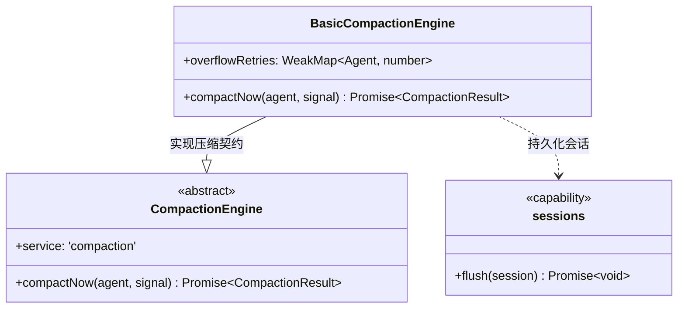

# ehm PoC —— 增强 UML 文本 → 可交互 H5

> **一句话**：`ehm` 接收一份「mermaid 结构 + `%% ehm` 数据」的 Markdown 文本和一组工作区根目录，
> 从真实源码里取出代码证据，物化成一份**自包含 H5 页面**和一份**结构化 IR**，返回一个 URL；
> 页面上的每次点击 POST 给宿主的 jump endpoint，由宿主决定怎么跳。
>
> **本目录是 [IMPLEMENTATION-PLAN.md](../IMPLEMENTATION-PLAN.md) 里 ②（门面）与 ③（Server）的
> 可运行证明**：不是设计稿，是能跑、能断言、能截图的东西。契约以 `spec/` 与
> [IMPLEMENTATION-PLAN.md](../IMPLEMENTATION-PLAN.md) 为准；本文只描述**当前实现**。
>
> 上一代"IR → HTML"命令行、MCP server、旧冒烟测试与旧产物已全部删除。
> 现在只有一条链路：**`.ehm.md` → 物化 IR → H5**；旧文档里关于 MCP 面与 0.1 IR 的内容不再适用。

---

## 1. 30 秒跑通

```powershell
cd <仓库根>

# ① 新链路冒烟：解析 → 物化 → IR → H5 → server → facade → CLI 完整形态 → P13 约束/skill（真实文件 + 真实子进程）
node poc\test\ehm.smoke.mjs
#    → 163 passed / 0 failed（原 133 + P13 新增组 7：member.summary / 范围与可见性诊断 / ehm skill / framework 样板）

# ② 增强 UML 文本 → H5，拿一个 URL（首次会自动拉起后端）
node poc\bin\ehm.mjs render poc\samples\compaction.ehm.md `
     --root D:\dsh-mydsh\deepseek-harness --title "compaction 能力接缝" --json

# ③ CLI 完整形态（可安装命令；命令表与选项见 §2.3）
node poc\bin\ehm.mjs --version                       # enhance-mermaid 0.1.0
node poc\bin\ehm.mjs validate spec\sample.ir.json              # 校验 IR（`-` 读 stdin）
node poc\bin\ehm.mjs validate spec\sample.ir.json --json       # { ok:true, stats:{entities:12,…} }
node poc\bin\ehm.mjs skill                                     # AI 作者指南 skills/ehm-uml/SKILL.md
node poc\bin\ehm.mjs skill --json                              # { ok:true, path, content }
node poc\bin\ehm.mjs render poc\samples\compaction.ehm.md `
     --root D:\dsh-mydsh\deepseek-harness --strict --json      # 歧义升级 E_AMBIGUOUS：仍出图但 exit 1

# ④ 后端状态 / 停止（都支持 --json）
node poc\bin\ehm.mjs server status --json
node poc\bin\ehm.mjs server stop

# ⑤ 校验 IR（零依赖校验器；spec/sample.ir.json 是 12 实体 / 13 关系的权威样例）
node spec\validate.mjs spec\sample.ir.json
#    也支持 stdin（`-`）：Get-Content spec\sample.ir.json -Raw | node spec\validate.mjs -

# ⑥ 可选：额外导出 file:// 可双击的单文件产物
node poc\bin\ehm.mjs render poc\samples\compaction.ehm.md `
     --root D:\dsh-mydsh\deepseek-harness --title "compaction 能力接缝" `
     --out dist\ehm-demo.html --json

# ⑦ 可选：重拍 7 张视觉验收截图（需要本机有 Chrome / Edge）
node poc\tools\shots.mjs

# ⑧ 可选：stdin 直送（不落盘；裸 `-` 表示从 stdin 读）
Get-Content poc\samples\compaction.ehm.md -Raw | node poc\bin\ehm.mjs render - `
     --root D:\dsh-mydsh\deepseek-harness --title "stdin 图" --json

# ⑨ 可选：小用例验证真实布线质量（相交/重叠/穿卡/斜线必须全 0）
node poc\tools\route-quality.mjs          # TB（默认）
node poc\tools\route-quality.mjs --lr     # LR
```

**前置条件**

| 条件 | 说明 |
| --- | --- |
| 真实源码仓库 | 默认 `D:/dsh-mydsh/deepseek-harness`。`poc/test/ehm.smoke.mjs` 里 `SRC_ROOT` 是硬编码；换机器需改这一行 |
| Node.js | 实测 `v24.17.0`；零 npm 依赖，**不要** `npm install` |
| Chrome / Edge | 只有截图脚本 `poc/tools/shots.mjs` 需要（CDP + headless） |

**实测输出**（2026-11-11 晚 P8 收口，样例已扩到 12 实体 / 13 关系 / 12 个调用点；端口每次不同属正常）：

```text
$ node poc/bin/ehm.mjs --version
enhance-mermaid 0.1.0

$ node poc/bin/ehm.mjs render poc/samples/compaction.ehm.md --root D:/dsh-mydsh/deepseek-harness --title "compaction 能力接缝"
ehm: 后端未运行，已拉起（pid 53968）          # stderr
EHM 渲染完成
  url       = http://127.0.0.1:2205/e/973922dad722
  data      = C:\Users\Administrator\.ehm\docs\973922dad722.json
  title     = compaction 能力接缝   scope=default
  实体/关系  = 12 / 13
  调用点    = 12
  html/ir   = 245.9 KiB / 44.3 KiB（P13 后 HTML；IR 以 --json 实际输出为准）

$ node poc/bin/ehm.mjs server status
ehm server: 运行中  http://127.0.0.1:2205  (pid 53968, v0.1.0)
  文档数 = 1, 已运行 0s

$ node poc/bin/ehm.mjs server status --json
{
  "ok": true,
  "running": true,
  "port": 2205,
  "baseUrl": "http://127.0.0.1:2205",
  "pid": 53968,
  "version": "0.1.0",
  "docs": 1,
  "uptime": 0,
  "uptimeMs": 441,
  "startedAt": "2026-11-11T07:40:53.102Z"
}

$ node poc/bin/ehm.mjs server stop
ehm server: 已停止（端口 2205）

$ node spec/validate.mjs spec/sample.ir.json
EHM IR 1.0.0 — spec/sample.ir.json
  实体 12 · 关系 13 · 视图 4 · 传输体积 28608 B (27.9 KiB) · 文件体积 41924 B · evidenceMode=inline
  …
✓ 通过

$ node poc/bin/ehm.mjs validate spec/sample.ir.json
EHM IR 1.0.0 — spec/sample.ir.json
  实体 12 · 关系 13 · 视图 4 · 传输体积 28608 B (27.9 KiB) · 文件体积 41924 B · evidenceMode=inline
  …
✓ 通过
```

**`--strict` 实测**（两个临时 root 里放同名 `pkg/dup.ts`，同一份 mini UML 引用它）：

```text
$ ehm render dup.ehm.md --root A --root B --title "strict demo"
EHM 渲染完成
  url       = http://127.0.0.1:7772/e/7977ebd84c6a
  …
  WARN W_AMBIGUOUS  "pkg/dup.ts" 在多个 root 下命中，已取第一个：…\A\pkg\dup.ts（另有 1 个）
  WARN W_UNBALANCED  "pkg/dup.ts:1" 起的花括号没配平，已取到文件末尾
（exit 0）

$ ehm render dup.ehm.md --root A --root B --title "strict demo" --strict
EHM 渲染完成（strict）
  url       = http://127.0.0.1:7772/e/7977ebd84c6a
  …
  ERROR E_AMBIGUOUS  [strict] "pkg/dup.ts" 在多个 root 下命中，已取第一个：…\A\pkg\dup.ts（另有 1 个）
  WARN W_UNBALANCED  "pkg/dup.ts:1" 起的花括号没配平，已取到文件末尾
ehm render: strict 模式判定失败（1 个 error）→ exit 1；图/URL 仍然有效   # stderr
（exit 1）
```

---

## 2. 形态：三个进程，一条 HTTP 通路

```
① Agent 宿主（长命）              ② ehm 门面（短命 / 每次调用）          ③ ehm Server（长命，一个）
   exec ────────────────────────►  ehm render
   { uml 文件 / stdin +             读文件 + parseArgs                   POST /api/render
     --root ×N +                    读 ~/.ehm/server.json 找后端           解析 mermaid + %% 指令
     --jump-endpoint }              没有就 detached 拉起 ehm serve        按 roots 读真实源码、抽代码
                                    转发 /api/render（60s 超时）          物化 IR → 生成自包含 H5
   ◄──── stdout JSON ─────────────  { url, dataPath, stats,            按 (scope,title) 存快照 + 落盘
     { url, dataPath, id }            diagnostics }                     静态服务 + jump 转发
                                                                        空闲 30 min 自退

④ WebView ──GET /e/<id>──► ③ ── 点击 → POST /jump/<id> ──► ③ ──POST──► ① 的 jumpEndpoint
```

**Agent 永远不碰 HTTP、不碰端口**：端口只有 ③ 知道，② 把 URL 字符串交给 ①。
页面只认自己的 origin，不知道 jump endpoint 在哪。

### 职责边界（硬）

| 层 | 职责 | 明确不做 |
| --- | --- | --- |
| ① Agent 宿主 | 产结构（mermaid + 行号）、给 jumpEndpoint、决定何时重画；收 jump 后决定怎么跳 | 不渲染、不解析、不打包 viewer |
| ② 门面 `poc/bin/ehm.mjs` + `poc/src/facade.mjs` | 解析 argv、读输入文件、发现/拉起后端、转发、打印 JSON；`--out` 时额外导出一份静态 HTML | 不解析 UML、不读被物化源码、不打包 dagre |
| ③ Server `poc/src/server.mjs` | 解析 + 物化 + 生成 H5 + 快照 + 静态服务 + jump 转发 | 不做实时刷新、不留历史版本、不探测 IDE、不决定跳哪 |
| ④ WebView / 宿主壳 | 拿 URL 走 WebView；或拿 `dataPath`/`/e/<id>.json` 用自己的组件重绘（需自行布局） | — |

### 源码分工

| 文件 | 作用 |
| --- | --- |
| `poc/bin/ehm.mjs` | CLI 唯一入口：`render`（文件或 stdin）/ `serve` / `validate` / `server status` / `server stop` / `--version` / `--help`；参数解析与人类可读输出 |
| `poc/src/parse-uml.mjs` | 增强 UML 文本 → 模型（mermaid 结构 + `%% ehm` 指令；宽容解析） |
| `poc/src/materialize.mjs` | 模型 + roots → 带 `evidence.code` 的模型（路径解析、花括号配平、8000 字符截断、诊断） |
| `poc/src/to-ir.mjs` | 物化模型 → EHM IR 1.0.0（视图按边类型拆 facet、`provenance=heuristic`） |
| `poc/src/html.mjs` | IR → 自包含单文件 H5（内联 dagre + css + viewer + IR；含生成时间角标与 jump/剪贴板降级） |
| `poc/src/server.mjs` | HTTP 服务：`/api/render`、`/e/<id>`、`/e/<id>.json`、`/e/<id>/stale`、`/jump/<id>`、`/healthz`、`/api/shutdown`；快照仓（LRU 64）与磁盘落盘 |
| `poc/src/facade.mjs` | 门面逻辑：读/拉起后端、转发、`server status/stop` |
| `poc/viewer/ehm-viewer.js` | 渲染器本体（≈101 KiB（103,287 B），零依赖，只用 `poc/vendor/dagre.bundle.js`） |

### 2.3 CLI 完整形态（P8-2：可安装命令）

根 `package.json` 把本 PoC 变成可安装的 npm 包（**零依赖，不需要 `npm install` 也能从源码直接跑**）：

| 字段 | 值 |
| --- | --- |
| `name` / `version` | `enhance-mermaid` / `0.1.0` |
| `bin` | `{ "ehm": "./poc/bin/ehm.mjs" }`（版本号从根 `package.json` 读，CLI / 后端 `/healthz` / 包三处同源） |
| `engines.node` | `>=20.11.0`（实测 Node v24.17.0） |
| `exports` | `.` → `poc/src/server.mjs`；`./facade`、`./materialize`、`./parse-uml`、`./to-ir`、`./html`、`./spec/validate` |
| `files` | `poc/bin`、`poc/src`、`poc/viewer`、`poc/vendor`、`poc/samples`、`spec/{ehm.ir.schema.json,sample.ir.json,validate.mjs}`、`skills/`（P13 加入）、`README.md` |
| `scripts` | `test` = `node poc/test/ehm.smoke.mjs`；`test:ir` = 校验 + 自测；`test:route` = 小用例布线质量；`ehm` = 直接跑 bin |

**命令与选项**

| 命令 | 作用 | 选项 |
| --- | --- | --- |
| `ehm render <file.ehm.md\|->` | 渲染 H5 快照，打印 URL（后端没跑自动拉起；`-` 从 stdin 读） | `--root <dir>`（**可重复**，按顺序首个命中者胜，必填）、`--title <text>`、`--scope <id>`、`--strict`、`--direction <lr\|tb>`（默认 **tb 纵向**，也接受 horizontal/vertical）、`--jump-endpoint <url>`、`--theme <dark\|light>`、`--json`、`--out <file.html>`、`--quiet`、`-h/--help` |
| `ehm serve` | 前台运行后端（长命；空闲 30 min 自退） | `--port <n>`（`0` 自动分配）、`--host <host>`、`--quiet` |
| `ehm validate <ir.json\|->` | 等价于 `node spec/validate.mjs`；直接复用校验器 | `--json`、`--check-files`（额外读盘核对 evidence 行号）、`--selftest` |
| `ehm skill [--json]` | 输出 AI 作者指南 `skills/ehm-uml/SKILL.md`（P13；恒读仓库文件，单一事实来源） | `--json`（`{ok,path,content}`）、`-h/--help` |
| `ehm server status` / `ehm server stop` | 后端状态 / 停止 | `--json`（status：`{ok,running,port,baseUrl,pid,version,docs,uptime,uptimeMs,startedAt}`；stop：`{ok,stopped,port}`） |
| `ehm --version` / `-v` · `ehm --help` / `-h` | 版本（`enhance-mermaid 0.1.0`）/ 帮助（含 AI 硬约束：完整 ranges / 方法 summary / 可见性 / file:line 核对 / 关系标签避开 `--` / roots / diagnostics） | 6 份 help：全局 + `render` / `serve` / `validate` / `skill` / `server` |

**`--strict` 语义（已实现，P8-2）**：多个 root 命中同一相对路径时，非 strict 是 `W_AMBIGUOUS` 警告（行为不变）；`--strict` 升级为 **error `E_AMBIGUOUS`**（仍取第一个命中者、**图/URL 照样产出**），只要诊断里有 error 就 **exit 1**。服务端 `/api/render` 同样支持 `strict:true`。

**退出码**

| 码 | 含义 |
| --- | --- |
| `0` | 成功；非 strict 允许 warning（含 `W_AMBIGUOUS`） |
| `1` | 渲染失败 / strict 下有 error / `server status` 未运行 / `server stop` 没停掉 / `validate` 有 error |
| `2` | 用法或读取错误（未知参数、缺 `--root`、读不了输入文件等；`validate` 透传校验器） |

**状态目录 `EHM_HOME`**（默认 `~/.ehm`）：`server.json` 记录 `{port,host,baseUrl,pid,version,startedAt}`（`stop` 后 `{stopped:true}`），`docs/` 存 `<id>.json` + `<id>.html` 快照。测试与插件都用临时 `EHM_HOME` 隔离，不碰用户真实状态。

**安装方式（任选；本仓库零依赖、免构建）**

```powershell
# 方式 A：源码目录内直接 npm link（开发机常用）
npm link                # 之后全局 `ehm` 可用
# 方式 B：安装到指定前缀
npm i -g .
# 方式 C：打包后到别处安装（npm pack 只需要 node/npm，不联网）
npm pack --dry-run      # 自检打包清单（含 P13 新增的 skills/ehm-uml/SKILL.md；具体 files/解包体积以实际输出为准）
npm pack                # 产出 enhance-mermaid-0.1.0.tgz
npm i -g .\enhance-mermaid-0.1.0.tgz
```

**实测**：`ehm --version` → `enhance-mermaid 0.1.0`；解包（`npm pack` → 解 tarball）后 `version` / `help` / `validate` / `render` / `skill` / `stop` 全通；从任意 cwd 用绝对路径调用 `poc/bin/ehm.mjs` 渲染成功（CLI 不依赖 cwd）。

---

## 3. 输入：一份增强 UML 文本

一个 `.ehm.md` 文件 = **一个 `mermaid classDiagram` 块（唯一结构来源）+ 若干 `%% ehm` 指令（补数据）**。
指令活在 mermaid 的 `%%` 注释里，所以同一份文本在 GitHub / VS Code 里就是一张普通 UML 图。

### 3.1 语法示例（节选，非仓库样例全文）

````markdown
# compaction 能力接缝



%% ehm:v1
%% entity CompactionEngine file=packages/compaction/compaction/src/index.ts line=96 summary="压缩服务的抽象基类"
%% entity BasicCompactionEngine file=packages/compaction/compaction-basic/src/index.ts line=104
%% entity sessions file=packages/compaction/compaction-basic/src/index.ts line=397
%% member BasicCompactionEngine.compactNow file=packages/compaction/compaction-basic/src/index.ts line=369
%% rel BasicCompactionEngine>CompactionEngine line=104
%% rel BasicCompactionEngine>sessions line=397
%% site BasicCompactionEngine>sessions file=packages/compaction/compaction-basic/src/index.ts line=397 column=13
%% site BasicCompactionEngine>sessions file=packages/compaction/compaction-basic/src/index.ts line=338 column=9
````

> 完整样例见 [`poc/samples/compaction.ehm.md`](./samples/compaction.ehm.md)：
> **12 实体 / 13 关系 / 12 个调用点**，与 [`spec/sample.ir.json`](../spec/sample.ir.json) 对齐，
> 所有 `file:line` 均对 `D:/dsh-mydsh/deepseek-harness` 的真实源码逐行核对过。

### 3.2 支持的 mermaid 子集

| 写法 | 说明 |
| --- | --- |
| `class Foo` / `class Foo {` … `}` / `class Foo <<stereotype>>` | 类声明；`class Foo["label"]` 的 label 被忽略 |
| 类体内成员行 | `+name: type` / `+name(params) Return` / `+name`；可见性 `+ - # ~`；尾部 `*` 抽象、`$` 静态 |
| `Foo : +name(params) Return` | 类体外成员写法，同样支持 |
| 关系 | `A --|> B`、`A ..> B`、`A --> B`、`A -- B`、`A *-- B`、`A o-- B`、`A ..|> B`（反向箭头同样识别） |
| 关系标签 | 箭头后 `: 动作目的`（推荐写"做什么"，不是"是什么"） |

**箭头 → IR 关系 kind**

| mermaid | IR `kind` | 视觉（viewer） |
| --- | --- | --- |
| `--|>` / `<|--` | `extends` | 实线 + 空心大三角 |
| `..|>` / `<|..` | `implements` | 实线 + 空心大三角 |
| `..>` / `<..` / `-->` / `<--` | `calls` | 实线 + 实心箭头 |
| `--` / `..` | `uses` | 虚线 + 空心箭头 |
| `*--` / `--*` | `contains` | 实线 + 空心三角 |
| `o--` / `--o` | `uses` | 虚线 + 空心箭头 |

**stereotype → IR 实体 kind**

| stereotype | kind |
| --- | --- |
| `<<interface>>` | `interface` |
| `<<capability>>` / `<<service>>` / `<<host-service>>` | `capability` |
| `<<function>>` | `function` |
| `<<module>>` / `<<plugin>>` / `<<command>>` | `module` |
| `<<type>>` / `<<enum>>` / `<<enumeration>>` | `type` |
| 其它 / 无 | `class` |

**不支持的语句**：`namespace` / `note` / `style` / `classDef` / `cssClass` / `link` / `click` / `callback`
→ 记 `W_SKIP_STATEMENT` 后跳过，**不中断**。

### 3.3 `%% ehm:v1` 指令表

所有指令都是 `%%` 注释行；**指令永远不能凭空创造实体或关系**，只能给 mermaid 已声明的东西补数据。

| 指令 | 作用 | 必填 | 可选键 |
| --- | --- | --- | --- |
| `%% ehm:v1` | 版本标记，出现即启用指令解析 | ✅ | — |
| `%% file <relpath>` | 设定后续声明的默认文件 | — | — |
| `%% entity <Name>` | 给实体补位置/说明/类型 | — | `file` `line` `lines` `summary` `kind` `stereotype` |
| `%% member <Entity>.<name>` | 给成员补位置与含义（成员名取 mermaid 里声明的名字） | — | `file` `line` `lines` `summary`（P13 起贯通到 IR） |
| `%% rel <From>><To>` | 给 mermaid 已声明的边补证据 | — | `file` `line` `label` |
| `%% site <From>><To>` | 追加一个调用点（可重复，×N 的数据来源） | — | `file` `line` `column` |
| `%% ehm:layout <k=v …>` | 布局提示（可选）：解析进 IR `meta.x-ehm.layout` | — | `rankdir` `ranksep` `nodesep` … |

约定：

- 值格式 `key=value`，空格分隔；值含空格用双引号：`summary="唯一实现：选区间、调 LLM、替换为摘要"`。
- 边的引用写 `From>To`（只比对两端，不管箭头类型）；同一对端点有多条边时用 `From>To#2` 指定第 2 条。
- 未知指令 → `W_UNKNOWN_DIRECTIVE`；未知键 → `W_UNKNOWN_KEY`；未知实体/成员/边 → 对应 `W_*` 警告。
- **P13 的 AI 约束**：方法有证据但缺 `summary` → `W_MEMBER_NO_SUMMARY`；证据只给一行（`lines=1`）→ `W_RANGE_THIN`；成员没写 UML 可见性 `+ - # ~` → `W_VISIBILITY_DEFAULT`。三条都是 warn、不阻断渲染；完整写法见 `ehm skill`（`skills/ehm-uml/SKILL.md`）与 `ehm render --help` 的「AI 硬约束」。
  **宽容解析**：一个笔误不会让整份失败。
- 没有 `%% ehm:v1` 块也是合法输入 → 退化为"纯 UML 图"（无代码正文、无跳转目标），记 `W_NO_EHM_BLOCK`。
- 没有 mermaid 块 → `E_NO_UML`（error，不抛异常）。

> 注意：`%% ehm:layout` 目前只写进 IR 的 `meta.x-ehm.layout`，**viewer v1 不消费**；
> 真要覆盖布局参数，通过 `render(ir, el, { layout: {...} })` 传（见 §6.2）。

---

## 4. 物化：文本 + roots → 带真实代码的 IR

物化只有三件事，全部**无智能**：路径解析、按行号取代码、失败降级但不中断。
**不做**符号搜索、不猜行号（行号是 Agent 刚读过代码给的，它才是那一刻的权威）、不做 AST 分析、
不读工作区外文件（绝对路径与 `..` 一律拒）。

### 4.1 路径解析

| 步骤 | 规则 |
| --- | --- |
| 起点 | 每条声明的 `file`（相对路径） |
| 解析 | 按 `--root` 顺序尝试 `join(root, file)`，**首个存在的文件胜** |
| 全失败 | 诊断 `E_PATH`，消息里列出所有尝试过的绝对路径；该实体降级为无代码 |
| 多命中 | 默认警告 `W_AMBIGUOUS`（取第一个）；`--strict` 时升级为 error `E_AMBIGUOUS`（仍取第一个，图照出但 exit 1） |
| 安全 | 拒绝绝对路径、拒绝 `..` 越界（也是 `E_PATH`） |

### 4.2 代码抽取

| 情况 | 行为 |
| --- | --- |
| 声明了 `lines` | 取 `[line, line+lines-1]` |
| 没声明 `lines`（实体/成员） | 从 `line` 起按**花括号配平**取到配平结束；跳过字符串 / 模板串 / 行注释 / 块注释里的 `{}` |
| 花括号没配平到文件尾 | 取到文件末尾并记 `W_UNBALANCED` |
| 超过 8000 字符（`MAX_CODE_CHARS`） | 按行边界截断，末尾追加显式注释 `// … 已截断：原文 N 行 / M 字符（打开源文件查看完整内容）`；`endLine` 同步调整，保证 `endLine - line + 1 == code 行数` |
| 关系证据 | 只取 `rel.line` 起 **3 行**上下文（"这行代码促成了这条关系"） |
| 调用点 site | 校验行号后取该行代码（最多 2000 字符），`endLine = line` |
| 成员没给 line | 静默（很常见），最后汇总一条 `W_MEMBER_NO_LINE`，不逐条刷屏 |

### 4.3 诊断（返回给 Agent，供其自我修正）

诊断形状：`{ code, level: 'error'|'warn', message, at?, line? }`。

| 码 | 级别 | 含义 |
| --- | --- | --- |
| `E_NO_UML` | error | 找不到 mermaid `classDiagram` 块 |
| `E_EHM_VERSION` | error | 不支持的指令版本（只支持 `v1`） |
| `E_PATH` | error | 路径不合法 / 在所有 root 下都不存在 |
| `E_LINE` | error | 行号越界（> 文件行数） |
| `E_READ` | error | 文件存在但读不了 |
| `E_NO_ROOT` | error | 没有提供任何 root（正常 CLI 会先拦住） |
| `E_AMBIGUOUS` | error | **strict 专属**：多个 root 命中同一相对路径（非 strict 时是 `W_AMBIGUOUS`） |
| `W_NO_EHM_BLOCK` | warn | 没有 `%% ehm:v1` 块：出图，但无代码/跳转 |
| `W_UNKNOWN_DIRECTIVE` / `W_UNKNOWN_KEY` / `W_BAD_ATTR` | warn | 未知指令 / 未知键 / 值解析失败，已忽略 |
| `W_UNKNOWN_ENTITY` / `W_UNKNOWN_MEMBER` / `W_UNKNOWN_REL` | warn | 指令引用了 mermaid 里不存在的东西，已忽略 |
| `W_SKIP_STATEMENT` | warn | 不支持的 mermaid 语句，已跳过 |
| `W_AMBIGUOUS` | warn | 多个 root 命中同一相对路径，取了第一个（`--strict` 升级为 `E_AMBIGUOUS`） |
| `W_NO_LINE` | warn | 实体/关系没有 `line`，取不到代码正文 |
| `W_MEMBER_NO_LINE` | warn | 汇总：N 个成员没有 line |
| `W_UNBALANCED` | warn | 花括号没配平，已取到文件末尾 |
| `W_RANGE_THIN` | warn | **P13**：实体/成员证据只给一行（`lines=1`），气泡里看不到完整实现 |
| `W_MEMBER_NO_SUMMARY` | warn | **P13**：方法有证据但缺 `summary`（成员含义） |
| `W_VISIBILITY_DEFAULT` | warn | **P13**：成员没写 UML 可见性 `+ - # ~`，缺省按 `+` 处理 |

**局部失败不中断**：出图 + 降级该卡片 + 把诊断放进返回值和 IR 的 `diagnostics`。
退出码：全成功 / 部分成功（只有 warning）→ `0`；**`--strict` 下只要诊断含 error → 仍产出图/URL 但 exit 1**（JSON 里 `ok:false`、`strict:true`、`errors[]`；人类输出给出 ERROR 列表）；后端完全失败（如 422 无实体）→ 门面输出 `ok:false`，退出码 `1`；用法/读输入错误 → `2`（见 §2.3）。

---

## 5. 输出与 HTTP 端点

### 5.1 门面 stdout（`--json`）

```json
{
  "ok": true,
  "strict": false,
  "id": "973922dad722",
  "url": "http://127.0.0.1:2205/e/973922dad722",
  "dataUrl": "http://127.0.0.1:2205/e/973922dad722.json",
  "dataPath": "C:\\Users\\Administrator\\.ehm\\docs\\973922dad722.json",
  "title": "compaction 能力接缝",
  "scope": "default",
  "stats": { "entities": 12, "relations": 13, "sites": 12, "htmlBytes": 232742, "irBytes": 45358 },
  "diagnostics": [],
  "baseUrl": "http://127.0.0.1:2205",
  "port": 2205,
  "httpStatus": 200,
  "errors": []
}
```

- 不带 `--json` → 人类可读摘要（本地模式：htmlPath / title / 实体关系数 / 诊断逐条；`--serve` 时仍是 URL）。
- 输入可以是文件路径，也可以是 `-`（从 stdin 读文本）；`ehm render --help` 里有示例。
- `--strict` → JSON 里 `strict:true`；有 error 时 `ok:false`、`errors[]` 给出 error 列表（URL 仍然有效，exit 1）。
- `--out <file.html>` → **本地模式（默认）**：只生成自包含 HTML、返回 `htmlPath`，不启动/连接 ehm server；
  `file://` 双击可开；未配置动作时点击降级为复制。
- `--local` → 显式本地模式（与 `--out` 同义；需要 `--out`）。
- `--serve` → 需要旧的 URL/后端能力时显式保留：先走 ehm server 拿 URL，再额外写 `--out`。
- **静态 HTML 跳转动作**（只作用于本地 `--out`，可重复）：
  - `--jump-action post:http://127.0.0.1:7333/jump` — POST `{file,line,column,symbol,...}`
  - `--jump-action 'open:vscode://file/{absPath}:{line}:{column}'` — 走系统 URL scheme 打开 IDE
  - `--jump-action copy` — 复制 `file:line:col`
  - `--jump-actions '["post:http://...","open:...","copy"]'` — JSON 数组形式
  - 占位符：`{file}` / `{absPath}` / `{fileUrl}` / `{line}` / `{column}` / `{symbol}`；路径会做 URL 编码。
  - 示例：
    ```bash
    ehm render doc.ehm.md --root . --out out.html \
      --jump-open 'vscode://file/{absPath}:{line}:{column}' \
      --jump-open 'cursor://file/{absPath}:{line}:{column}' \
      --jump-post http://127.0.0.1:7333/jump \
      --jump-action copy
    ```
  - **浏览器不能执行 shell cmd**；需要执行命令时由 `post` 目标的本地 helper 处理。`post` 到 `file://` 页面时注意 CORS / Private Network Access，服务端要放行。
- **本地 HTML 的消费方**：DSH Client 通过 `workspaceFiles.readBytes` 读取本地 HTML（不是 HTTP 代理页），用 sandbox Blob iframe 内联渲染；右栏/新标签打开同一个 `htmlPath`。`post` 和 IDE URL scheme 仍可独立使用。
- **为什么给 `dataPath` 而不是内联 IR**：结构化数据几十 KB，走 stdout 会被管道/终端截断。

### 5.2 HTTP 端点（③ Server，实际实现 7 个）

| 方法 | 路径 | 入参 | 出参 |
| --- | --- | --- | --- |
| `POST` | `/api/render` | `{ uml, roots[], title, scope, theme?, jumpEndpoint?, strict? }` | `{ ok, id, url, dataUrl, dataPath, title, scope, stats, diagnostics }` |
| `GET` | `/e/<id>` | — | H5（`text/html`；快照不在内存时 404） |
| `GET` | `/e/<id>.json` | — | IR 1.0.0（`application/json`） |
| `GET` | `/e/<id>/stale` | — | `{ changed, checkedAt, files: [{ file, mtime, snapshotMtime, missing? }] }`（mtime 为 ISO 字符串；未知 id → 404 JSON） |
| `POST` | `/jump/<id>` | `{ kind, file, line, column?, symbol?, … }` | `{ ok, forwarded, status? , reason?, error? }` |
| `GET` | `/healthz` | — | `{ ok, name, version, docs, uptimeMs }` |
| `POST` | `/api/shutdown` | — | `{ ok }`（`ehm server stop` 用） |

错误响应：非法 JSON body → `400`；缺 roots → `400`；UML 解析后无实体 → `422`；未知路径/id → `404`。

> 7 个端点与 [IMPLEMENTATION-PLAN.md §5](../IMPLEMENTATION-PLAN.md) 一致；
> `/e/<id>/stale` 与 H5 生成时间角标由 P7-5 补齐（见 IMPLEMENTATION-PLAN §12 完成记录）；
> P8 未新增端点，`/api/render` 增加 `strict:true`（歧义升级 `E_AMBIGUOUS`，P8-2）。

服务只监听 `127.0.0.1`；`ehm serve --port 0` 自动分配端口。

### 5.3 快照语义（已冻结）

| 规则 | 值 |
| --- | --- |
| key | `(scope, title)`；`scope` 缺省 `default`，`title` 缺省 `untitled` |
| id | `sha1(scope + "\0" + title)` 取前 12 位十六进制 → 同一 key 的 URL **稳定不变** |
| 重复请求 | **后写覆盖**，URL 不变；不同 title / 不同 scope → 不同 id |
| 实时性 | **不做**。快照就是请求那一刻的状态 |
| 历史版本 | 不保留 |
| 磁盘 | `~/.ehm/docs/<id>.json` + `<id>.html`；`EHM_HOME` 环境变量可覆盖 `~/.ehm` |
| 内存 | **LRU 64 条**（`SNAPSHOT_LIMIT = 64`）：页面 / 数据 / stale / jump 的每次访问都会把该快照移到队尾；超出上限淘汰最久未访问的，**磁盘文件不删** |
| 过期可见 | 渲染时记录每个源文件的绝对路径 + mtime；`GET /e/<id>/stale` 对比当前 mtime → `{ changed, checkedAt, files[] }`（文件被删则该项 `missing:true` 且 `changed:true`）。页面左下角显示生成时间角标，**不推送**、不自动重建 |
| 重启 | 内存快照清空：**服务重启后旧 URL 会 404**（磁盘文件仍在，但不会自动重新加载，需重新 render） |
| 状态文件 | `~/.ehm/server.json`：`{ port, host, baseUrl, pid, version, startedAt }`；`stop` 后写 `{ stopped: true }` |
| 空闲自退 | 30 分钟无请求自动退出（每 60s 检查一次） |

### 5.4 jump 转发

```
页面点击 → POST /jump/<id> { kind, file, line, column?, symbol?, … }
        │
        ├─ 该文档记录了 jumpEndpoint → 原样 POST 过去
        │      成功 → { ok:true, forwarded:true, status }
        │      失败 → { ok:false, forwarded:true, error }
        └─ 没有 jumpEndpoint → { ok:false, forwarded:false, reason:'no-jump-endpoint' }
                │
                └─ 页面收到 forwarded:false → 复制 `file:line:col` + toast
```

服务端**不解析 intent 的语义**，原样转发；`kind` 的取值当前由 viewer 决定
（`entity` / `field` / `method` / `relation`），计划里的 `definition` / `callSite` / `evidence`
尚未对齐——宿主应按 `file/line/symbol` 自己分派。

---

## 6. H5 页面与 viewer API

### 6.1 页面（`poc/src/html.mjs` 产物）

单文件自包含：**内联 dagre + CSS + viewer + IR**，没有 `<script src>` / `<link rel=stylesheet>`
外链，断网可开、`file://` 可开。点击动作由生成时的 `jumpActions` 决定：
`post`（POST 跳转意图）/ `open`（IDE/自定义 URL scheme）/ `copy`（复制位置）；没有动作时降级为 `copy`。

- 全局：`window.__EHM_IR__`（内联 IR）、`window.__EHM_META__`（theme/title/计数/docId/jumpUrl/**jumpActions/roots**/generatedAt）、
  `window.__viewer`（实例）、`window.__lastIntent`（最近一次点击意图）、
  `window.__EHM_DIAG__` + 隐藏的 `<pre id="ehm-diag">`（`diagnose()` 的 JSON，供自动化读取）。
- **生成时间角标**：页面左下角固定 `.ehm-stamp`，文本 `生成于 YYYY-MM-DD HH:mm:ss · <id>`
  （本地时区；时间源是 `ir.meta.generatedAt` 的 ISO UTC）。样式 `fixed left:12 bottom:8、pointer-events:none`，
  深浅主题各一套配色（`.ehm-stamp-light`），不挡卡片/气泡交互。
- `post`：fetch JSON；`forwarded:true` → toast「已交给宿主处理」；失败时若没有其它动作则复制位置。
- `open`：模板占位符 `{file}/{absPath}/{fileUrl}/{line}/{column}/{symbol}`，通过 `<a target=_blank>` 打开 `vscode://` / `cursor://` / `idea://` 等 URL scheme；浏览器会显示外部协议确认。
- `copy`：复制 `file:line:col` + toast。
- 旧 `jumpUrl` 兼容为单个 `post` 动作；静态 `--out` 没有动作时只复制，不发起网络请求。
- **独立窗口（P13/P14-9）**：viewer 不再自己分叉 standalone 逻辑；只要宿主提供 `onJump`，就统一交给页面层的 action 执行器（也修掉了 body 级 toast 与 viewer `.ehm-toast` 撞名后被 `opacity:0` 压透明的问题）。
- IR 缺失/渲染异常：页面显示 `.ehm-fallback` 文案，不白屏。

### 6.2 全局 API（`window.EHMViewer`）

```js
window.EHMViewer.render(ir, container, options)   // 主入口：返回实例
window.EHMViewer.mount(ir, container, options)    // 同义（对齐 spec 写法）
window.EHMViewer.normalizeIR(ir)                  // 纯函数：任意版本 IR → 内部统一形状
window.EHMViewer.normalize(ir)                    // normalizeIR 的旧名
window.EHMViewer.detectIrPath(ir)                 // → { path:'spec'|'legacy', version, major }
window.EHMViewer.kinds                            // 枚举与兼容映射表
```

**IR 必须作为参数传入。viewer 内部不 fetch、不读文件、不认任何宿主。**
`normalizeIR` 不碰 DOM 的渲染部分，但内部测字宽用 canvas，纯 node 里需要 shim。

`options`：

| 字段 | 类型 | 默认 | 说明 |
| --- | --- | --- | --- |
| `theme` | `'dark' \| 'light'` | `'dark'` | 兼容入口：映射到默认 DSH 深/浅主题 |
| `skin` | `'dsh-dark' \| 'dsh-light' \| 'graphite' \| 'editorial' \| 'carbon'` | `'dsh-dark'` | 初始主题（也可用顶栏「主题」菜单切换） |
| `methodsMode` | `'expanded' \| 'collapsed'` | `'expanded'` | 方法默认展开/折叠 |
| `layout` | `{ rankdir?, ranksep?, nodesep?, marginx?, marginy?, ranker? }` | 见 §7.5 | 覆盖 dagre 参数 |
| `onJump` | `(target) => void` | 复制 `file:line:col` + toast | 跳转回调 |

**`onJump(target)` 形状**：

```js
{
  file: string,          // 'packages/compaction/compaction-basic/src/index.ts'
  line: number,          // 1-based
  column: number,        // 1-based（当前实现固定 1）
  symbol: string,        // 'BasicCompactionEngine.compactNow' / 关系标签
  edgeId: string|null,   // 关系线跳转时是关系 id；实体/成员跳转时 null
  kind: 'entity'|'field'|'method'|'relation',
  entityId?: string,
  memberId?: string,     // 成员跳转时
}
```

默认降级实现是 `navigator.clipboard.writeText('file:line:col')` + toast；viewer 源码里**没有**
`location.href`、`vscode://`、`ui/open-link` —— 跳转必须由宿主通过 `onJump` 接管。

### 6.3 实例 API

```js
const v = window.EHMViewer.render(ir, el, opts)
v.fit()                      // 适配视口
v.zoom(1.2)                  // 缩放（限制 0.22–2.6）
v.setTheme('light')          // 兼容入口：切到 DSH 浅色
v.setSkin('graphite')        // 切到 Graphite（5 套见 §7.0）
v.getSkin()                  // 当前主题 id
v.getTheme()                 // 'dark' | 'light'（由 skin 推导）
v.setMethodsMode('collapsed')// 折叠方法并重新布局
v.relayout()                 // 重新布局 + 适配（容器尺寸变化时）
v.diagnose()                 // 几何诊断（供自动化断言，见 §8.1）
v.model                      // normalizeIR 的产物
v.root / v.stage / v.content / v.bubble   // 调试用 DOM 引用
v.simulateJump('entity'|'member'|'relation')  // 走与真实点击完全相同的 onJump 路径
v.destroy()                  // 清理
```

### 6.4 交互

| 行为 | 效果 |
| --- | --- |
| 悬停卡片头 / 字段行 / 方法行 | 弹出该符号的**真实代码气泡**（`evidence.code`，带行号）；方法/字段气泡 header 另显示 `summary`（P13，无则不占位） |
| 悬停关系线或它的标签 | 弹出该关系的 3 行证据代码，线 + 标签同步高亮 |
| **单击**卡片 / 字段 / 方法 / 线 | 选中该元素（`.ehm-selected` 高亮）并**固定**代码气泡，直到点击气泡外部；代码框不遮住被点对象 |
| **双击**卡片 / 字段 / 方法 / 线 | 调 `options.onJump`；**双击线条优先跳到关联方法**（toMethod → fromMethod → 证据行所在成员） |
| **Alt + 左键拖拽** | 平移画布（可从未选中卡片处开始，普通点击不会触发平移） |
| **Alt + 滚轮** | 以指针为中心缩放画布；普通滚轮不缩放 |
| **hover 气泡** | **纯展示**：`pointer-events:none`，不能滚动/选中/复制；滚轮穿透到画布，只有单击锁定后才可操作 |
| **离开 owner 600ms 内** | 仅做延迟关闭，避免相邻成员行之间移动时闪烁；hover 气泡不冻结、不接收后续操作 |
| **点击气泡外部** | 关闭固定气泡并清除选中态（监听挂在 **capture** 阶段，见 §7.7） |
| 滚轮（锁定气泡上） | 滚 `.ehm-bubble-scroll`，不缩放画布；hover 气泡上滚轮不拦截 |
| 双击空白 | **保持当前视图**（不重置、不适配）；按键 `0` 适配视口 |
| 按键 `+` / `-` | 放大 / 缩小 |
| 顶栏按钮 | 适配 / **在侧栏打开** / **主题**；「主题」打开 5 套内置主题菜单（默认 DSH 深色 / DSH 浅色 / Graphite / Editorial Technical / Carbon）；「在侧栏打开」向 DSH 父窗口 postMessage，由 Client 半打开右侧 EHM tab |

---

## 7. 布局 / 走线 / 气泡实现要点（39 轮买来的经验）

### 7.0 视觉 / 主题系统（P14-7）

- **默认主题**：`dsh-dark` / `dsh-light`，贴近宿主 DSH：52px 顶栏、8px 圆角卡片、单一蓝锚点、轻量阴影和极淡点阵；默认 `dsh-dark`。
- **内置主题**（顶栏「主题」菜单，5 套）：
  - `dsh-dark` / `dsh-light` — 默认 DSH 深/浅
  - `graphite` — 低彩度技术灰 + 黄铜交互色，技术感来自端口/线型/类型轨，不靠大面积蓝色
  - `editorial` — 暖纸 + 安全橙，技术纸本
  - `carbon` — 石墨 + 钴蓝，工业仪表
- **结构**：DSH 主题用圆角和轻量层次；Graphite/Carbon/Editorial 保留直角、细线、类型轨。实体 kind 由 `«stereotype»` 表达，不再用五种彩色报头。
- **字体**：Inter / Helvetica Neue / PingFang SC；元信息与代码用 JetBrains Mono / IBM Plex Mono / Consolas。`FONT` 常量与 CSS 必须同组，canvas 量宽才和 DOM 一致。
- **画布**：24px 点阵；DSH 主题不画大网格，Graphite/Editorial/Carbon 才显示 96px 极淡技术网格。
- **气泡**：DSH 主题圆角柔和阴影；Graphite/Carbon/Editorial 硬边/硬偏移；代码区固定深色。
- **端点**：每条关系起点画 4.4px 端口方块、终点用箭头帽；密集图里能一眼看出线从哪端出发、到哪端结束。
- **交互文案**：顶栏「适配 / 在侧栏打开 / 主题」；「在侧栏打开」通过同源 postMessage 让 DSH Client 打开右侧 EHM tab。

**不重写布局算法、走线算法、气泡状态机、dagre 参数**——这些是 prototypes v1–v14 反复试错后的结论，
viewer 只是把它们收敛成一份可移植代码。以下每条都对应过真实 bug。

### 7.1 两遍布局（K1：必须真量，不能量估算值）

```
① 估算尺寸跑 dagre（LR）→ 摆卡片（卡片 width:auto + ehm-measuring，关 ellipsis）
② 同步读 offsetWidth / offsetHeight（不用 requestAnimationFrame —— headless 下 rAF 可能不触发）
③ 用真实尺寸重跑 dagre + 重算走线 → 正式绘制
```

**踩过的坑**：最初的实现里第一遍就把卡片宽度写成估算值 `width:XXXpx`，于是第②步量到的**永远等于估算值**
——两遍布局退化成"量估算值 → 用估算值"，白跑一遍。症状是某张卡片的方法签名比估算宽 14px，
文字被 ellipsis 裁掉，而诊断一直显示"零溢出"。
**修法**：第一遍给卡片加 `.ehm-measuring`（`width:auto` + 关闭 ellipsis），让浏览器按内容自然撑开；
第二遍才用布局宽度。另外 `sizesFor` 取 `max(实测, 估算)`，防止 CSS 压缩导致布局偏小。

### 7.2 正交走线（K2/K3）

- **dagre 的 `points` 不是折线拐点**，是「源边界 → 通道 → 目标边界」的通道落点。直接连必然全斜。
- 做法：从源卡片边缘按端口比例起笔 → 沿通道 x 竖直走 → 到目标高度 → 水平接入 → 收在目标边缘。
- **端口均分**：同一卡片的多条出/入边沿边缘按比例排开（`outSlot` / `inSlot`）。
- **通道避让**：`pickLane` 从 dagre 给的中间点里挑，避开已占用通道。
- **竖直段分离**：dagre 在普通图上不分配边通道，后处理把重叠的竖直段横向推开（`PARALLEL_GAP = 10`）。
- **防穿卡**：每条线试 4 个横向偏移（`baseShift / 0 / ±PARALLEL_GAP`），选第一条不穿任何卡片的；
  都不行才退回默认偏移。
- **平行边**：同组多条边横向错开 10px，但不画分支汇聚符。

### 7.3 方法级端口（K4：本项目的核心视觉能力）

关系带 `fromMethod` / `toMethod` 时，折线的首/尾 y **必须落在对应成员行的中线**，
而不是卡片中心；否则"点调用点跳调用处"在视觉上没有落点，方法行悬停高亮也和线对不上。

实现：`memberYIn(box, entity, memberName, entityLayout)` 按
`headH + 分区 padding + index × ROW_H + ROW_H/2` 算出绝对 y，作为 `portOverride` 传给走线器。

**可断言**：`diagnose().methodPorts` 报告 `{checked, ok, bad[], missing[]}`；
断言口径是 `bad=0 && missing=0 && ok=checked`（容差 ±ROW_H）。

### 7.4 标签（K5）

- 标签宽度/高度**参与 dagre 布局**（setEdge 时传入），否则 dagre 不知道标签要占地方。
- 渲染时**不用 dagre 的 `labelPos`**：那是"标签中心落在通道上"的坐标，正交化之后通常正好在竖直通道中段，
  放上去必然压线。
- 改为优先挑"足够长的水平段"，标签沿该段滑动 + 推到线的上下方。
- 摆放用**候选枚举 + 打分**：越界(4000) > 压卡片(3000) > 压别人的线(2000) > 压标签(1200)，再叠距离代价。

### 7.5 dagre 参数

```js
{ rankdir: 'LR', ranksep: 112, nodesep: 34, marginx: 8, marginy: 8, ranker: 'network-simplex' }
```

（prototype14 最终采用 `rankdir: 'LR'` / `ranksep: 96` / `nodesep: 30`，见 `prototypes/v14/README.md`；
本图右列卡片更多，取 112/34 让整图在 1800×1400 视口里接近 1:1。）
画布外扩 `PAD = 56px`。

### 7.6 气泡（K6：三态 + 鼠标优先 + owner 禁入，P8-1 回归 v14 设计）

状态：`none` / `hover` / `locked`（单击选中并固定；点气泡外部关闭并清除选中态，见 §7.7）。

**定位第一原则：绝不盖住 owner（被悬停的实体头 / 字段行 / 方法行 / 连线局部锚点），并贴着鼠标。**
实现对应 `positionBubble()`，设计直接回归 `prototypes/v14/demo/uml.js:115-227`（用户已接受）：

1. **候选方位**（全部先 clamp 进视口，pad = 8，offset = 18px）：
   - 鼠标四向：右下 / 左下 / 右上 / 左上（默认锚点，保证贴近鼠标）；
   - owner 右 / 左（纵向对齐鼠标）、owner 下 / 上（横向对齐鼠标）、owner 四角；
   - owner 在卡片内时（实体头 / 字段行 / 方法行），补一组「**整卡外侧**」候选（下 / 上 / 右 / 左）
     —— owner 四向会被卡片自身挡住，没有这组候选只能二选一：要么压卡片、要么把气泡甩远。
2. **硬约束**：在「不与 owner 相交」的候选里挑；只有全部候选都压 owner（owner 比视口还大 / 视口极小）时，
   才退化为 v14 的兜底「owner 重叠面积最小」。
3. **候选排序**：先「完全不压其他卡片」→ 再「压卡片面积最小」→ 最后「离鼠标最近」。
4. **高度**用自然高度，`maxHeight = min(自然高, 视口高 − 16)`，超出时内部滚动；**不再**用「每次缩 12%」
   的旧补丁——气泡高度不该为定位让步。
5. 宽度按最长代码行撑开（量 `.ehm-src` 的 `scrollWidth`），下限 320px、上限 `max(320, 视口宽 − 40)`；超宽水平滚动（`h-overflow`）。
6. `hover` 态在 `mousemove` 时重新定位（跟随鼠标）；`locked` 态位置冻结。

**P13 补的三条交互（都有 E2E/单测覆盖）**：

- **hover 宽限 600ms**：离开 owner 后只做短暂延迟关闭，避免相邻行移动闪烁；hover 气泡不冻结、不接收滚轮/选中。
- **只有锁定气泡可滚代码**：hover 态 `.ehm-bubble` 是 `pointer-events:none`；wheel 处理器只在 `state==='locked'` 且事件目标在气泡内时拦截，避免鼠标快速掠过气泡时打断画布/页面滚动。
- **成员气泡 header 显示 `summary`**：IR `member.summary`（`%% member ... summary=` 贯通 parse→materialize→IR）渲染在声明行下方一行 muted 小字；没有 summary 时**完全不占位**，不会留空行。

**独立窗口跳转**：viewer 不再自己分叉 standalone 逻辑；只要宿主提供 `onJump`（H5 壳总会提供），点击统一交给页面层的 `post/open/copy` 执行器。没有动作时复制位置 + toast；有 `post` 时发请求；有 `open` 时走 IDE URL scheme。`.ehm-toast` 与 html 壳 body 级 toast 的命名冲突（全局 `opacity:0` 导致「点了没反应」）已在 P13 修复。

**连线悬停的 owner 修正**：不再传整条 `<g>` 的 bbox（一条关系横跨大半个画布，会把气泡推到天边），
改为以**鼠标点为中心的小矩形（±7px）** 作为 owner；鼠标正压在标签上时再把标签矩形并进去
（标签就是被悬停元素，不能被盖住）。实体/字段/方法行仍用元素自身 rect 作 owner。

> **为什么推倒旧的「空白矩形搜索」**：旧实现把全部卡片当禁入区、在网格格点上按
> `overlap*1000 + dist*0.5 + 缩高*2` 打分，卡片一密集就把气泡丢到离鼠标很远的屏幕角落，
> 找不到空位时还会压住 owner —— 这正是用户反馈「悬停代码框没出现在鼠标附近、还挡住悬停元素」的根因。
> 该算法是被用户否掉的**回归**，已删除；P8-1 之后的三类场景硬断言见 §8.3。

**P8-1 顺带修掉的两个既有 viewer bug（诚实记录）**：

- **`makeCompartment()` 闭包 bug**：循环里用 `var` 直接闭包，所有方法行都指向最后一行
  ——表现为「悬停任意方法行都显示最后一个方法的代码」。改用 IIFE 把当前 `row` 绑进闭包。
- **`fitBubbleWidth()` 量错元素**：原先量块级行容器 `.ehm-code-line` 的 `scrollWidth`（等于容器宽度），
  气泡每 hover 一次就变宽 ~80px、连续悬停后撑满屏幕。改为量代码文本本身 `.ehm-src` 的 `scrollWidth`。

### 7.7 外部点击关闭必须挂 capture（K7）

气泡自己的 `mousedown` 会 `stopPropagation()`；关闭监听若挂在冒泡阶段会被抢先拦掉，**永远关不掉**。
必须 `addEventListener('mousedown', handler, { capture: true })`，并判断 `bubbleEl.contains(e.target)`。

### 7.8 其他固定下来的经验

| # | 经验 | 原因 |
| --- | --- | --- |
| K8 | 高度/行距诊断用 `offsetTop` / `offsetHeight`，不用 `getBoundingClientRect` | 画布 `scale≠1` 时矩形被 transform 放大，21px 行距会量成 23px，全假阳性 |
| K9 | 折叠态多出的「« N 个方法已折叠 »」行必须计入 `methodBlockH` | 否则折叠后 8 处文字溢出 |
| K10 | `summary` 超 300px 折两行，高度计入 `headH` | 单行 nowrap + ellipsis 把类描述裁掉 |
| K11 | 1.0.0 的 kind（`module`/`file`/`class`/`interface`/`function`/`type`/`capability`/…）都要映射到配色类，别落默认色；继承类判断同时认 `extends` / `implements` | 否则 interface 掉默认色、继承线不显示空心三角 |
| K12 | 方法/字段行 `mousedown` 要 `stopPropagation`，点击与拖拽平移互不干扰 | 否则点方法会触发画布拖拽 |
| K13 | viewer 源码禁止出现宿主专有字符串（`dsh`、`ctx.`、`vscode://`、`fetch(`、`location.href`） | 可移植性硬约束（上一代冒烟测试组 0 有 7 条断言；新冒烟未包含，改动 viewer 时靠人工 grep 守住） |
| K14 | hover 气泡是纯展示层，不能处理滚轮/选中 | hover 态 `pointer-events:none`；wheel 只在 `state==='locked'` 且 target 在气泡内才滚代码，否则鼠标快速掠过会打断画布/页面滚动 |
| K15 | 独立窗口 toast 不能与 html 壳的 body toast 共用类名 | 壳的 `.ehm-toast{opacity:0}` 会把 viewer toast 压透明，独立窗口点击像"没反应" |
| K16 | 成员 `summary` 为空时不渲染占位行 | 空行会撑高气泡 header，且让"有没有含义"看不出来 |

---

## 8. 测试与视觉验收

### 8.1 新链路冒烟（`node poc/test/ehm.smoke.mjs`）

覆盖：解析 → 物化 → IR → H5 → server → CLI。**真实文件 + 真实子进程，不做 mock**；
`EHM_HOME` 指向临时目录做隔离，结束时清理并停掉后端。
当前（2026-11-12 P13 收口，12 实体样例 + framework 样板）**163 passed / 0 failed**（原 133 + 组 7 = 21），分组与要点：

| 组 | 断言数 | 覆盖内容 |
| --- | --- | --- |
| 0. 解析 | 17 | mermaid 块识别、实体 12 / 关系 13（2 extends + 11 calls）、样例零诊断、`v1` 版本、extends 方向、stereotype→kind、成员 params/returns、重复端点对保留、sites 读入 12 个；**宽容性负例**（无指令块 / 不支持语句 / 无 mermaid 块） |
| 1. 物化 | 17 | 6 个源文件、12 实体 evidence.code、24 个关键成员 evidence、13 条关系 evidence、12 个调用点 file/line/code、无 `W_MEMBER_NO_LINE`、零 error；**负例**：`E_PATH`（含尝试路径）、`E_LINE`、`..` 与绝对路径拒绝、8000 字符截断带标记 |
| 2. IR | 15 | `schemaVersion=1.0.0`、实体 12 / 关系 13 / sites 12、id 合法、端点可解析、`provenance=heuristic`、`meta.generator.mode` 枚举、**`meta.generatedAt` 是 ISO 时间（角标数据源）**、标题收进 `x-ehm`、两个视图的 `foldResult` 口径、重复端点对关系 id 去重、**`node spec/validate.mjs` 真实校验物化产物 + `-` stdin 校验** |
| 3. H5 | 15 | 含 `EHMViewer.render` / `__EHM_IR__`、**内联 IR 可解析且 = 12 实体 / 13 关系**、12 个实体名在 IR 与原文都 grep 到、内联 IR 带代码正文（非 slim）、**生成时间角标（`.ehm-stamp`、`pointer-events:none`、深浅主题配色）且 `__EHM_META__.generatedAt` 与 IR 一致**、无旧标识残留、无外链、内联 dagre、jumpUrl 写入、无 jumpUrl 时降级、`slimIr` 剥代码 |
| 4. server | 26 | healthz、`POST /api/render`（stats 12/13，**sites=12**）、`GET /e/<id>`（页面内联 IR 12/13、**服务端页面带生成时间角标**）、`GET /e/<id>.json`、dataPath 可读（12 实体）、**`GET /e/<id>/stale`**（刚 render 后 `changed=false`；临时 root 源文件 mtime 变化 → `changed=true`；源文件被删 → 该项 `missing=true`；未知 id → 404 JSON）、**内存 LRU 64**（70 次 render 后 `/healthz` docs=64、最早文档被淘汰 404、最近访问的保留 200）、jump 真实转发到假宿主并原样收到 intent、无 endpoint → `forwarded:false`、同 `(scope,title)` 覆盖同一 id、不同 title/scope 不同 id、400/404 |
| 5. CLI | 14 | `ehm render --json` 退出码/JSON 形状/url+diagnostics、CLI stats 12/13 且零 error、**`--json` 与人类可读输出含 `sites=12`**、**`render -` stdin 方式**（4 条：退出码 0、stderr 无"未知参数"、JSON stats 12/13、`--help` 的 stdin 用法与实现一致）、`server status` 运行中、`--out` 导出、`server stop`、停止后 status 退出码 1 |
| 6. CLI 完整形态（P8-2） | 29 | **可安装 bin**：`ehm --version`/`-v` 与根 `package.json` 一致、包字段（ESM/name/version/bin/engines/license/scripts.test/`exports`/`files`）齐全、bin 文件存在且从任意 cwd 用绝对路径可跑、5 份 help（全局 / render / serve / validate / server）内容完整；**`validate`**：文件 / `-` stdin / `--json` / 坏 IR 退出码 1；**`--strict`**：materialize 层 W_AMBIGUOUS → E_AMBIGUOUS、CLI 非 strict exit 0 且仍出 URL、strict exit 1 但 URL 仍产出、JSON `ok:false/strict:true/errors[]`、人类输出给 ERROR 列表、`/api/render strict:true` 与默认非 strict 行为；**`server status/stop --json`**：字段齐全、停止后 status exit 1 + `reason=not-running`、重复 stop 幂等；**CLI 不依赖 cwd** |
| 7. P13（member.summary / 约束诊断 / skill / 样板） | 21 | **member summary 贯通** parse→materialize→IR、viewer 成员气泡 header 读取；**三个新诊断**：`W_RANGE_THIN`（证据只一行）、`W_MEMBER_NO_SUMMARY`（方法缺含义）、`W_VISIBILITY_DEFAULT`（缺 `+ - # ~`）；**`ehm skill`**：输出 SKILL.md 原文（frontmatter + 关键约束/流程）、`--json` → `{ok,path,content}`、`--help`、`ehm --help` 含「AI 生成 EHM UML 的硬约束」+ skill 命令 + `summary`；**framework 合规样板** `poc/samples/framework.ehm.md`：14 实体 / 16 关系 / 解析零诊断、物化 0 诊断（含三个新警告）、每个类/方法/字段都有 summary、成员都有真实可见性、证据覆盖完整范围（lines≥2）、CLI stats 14/16 |

> 断言数随阶段改动变化；**以仓库当前文件的实际运行输出为准**（撰写本文时为 154；组 6 为 P8-2 新增，组 7 为 P13 新增）。

### 8.2 IR 契约校验

```powershell
node spec\validate.mjs spec\sample.ir.json   # 12 实体 / 13 关系 / 4 视图，✓ 通过
node spec\validate.mjs poc\sample.ir.json    # 调试夹具，内容与 spec 样例逐字节一致（sha256 相同）
# 也支持从 stdin 校验（`-`）：
Get-Content spec\sample.ir.json -Raw | node spec\validate.mjs -
```

### 8.3 视觉验收截图（`poc/tools/shots.mjs`）

用 headless Chrome + CDP（`--headless=new` + `--remote-debugging-port`）驱动：
加载 `dist/ehm-demo.html` → 悬停/单击选中固定/Alt+拖拽/Alt+滚轮/切主题/折叠 → `Page.captureScreenshot`。
默认 1800×1400 视口，读 `dist/ehm-demo.html`（可用 `--html <path>` 换文件）。

**产物**：`poc/shots/` 下 11 张 PNG + `shots-report.json`（由 `node poc/tools/shots.mjs` 从最终
`dist/ehm-demo.html` 生成）：

| 文件 | 内容 |
| --- | --- |
| `01-overview-dark.png` | 全图 · 默认 DSH 深色 |
| `02-hover-entity-bubble.png` | 悬停类头 → 代码气泡 |
| `04-bubble-locked.png` | 单击选中并固定气泡（可滚动/可选中） |
| `05-hover-wire-bubble.png` | 悬停关系标签 → 证据代码 + 线/标签同步高亮 |
| `06-theme-menu.png` | 主题菜单（5 套） |
| `06-overview-light.png` | 全图 · DSH 浅色 |
| `07-methods-collapsed.png` | 折叠方法模式 |
| `08-zoom-detail.png` | 放大到细节 |
| `09-theme-graphite.png` | Graphite 低彩度技术主题 |
| `09-theme-carbon.png` | Carbon 工业仪表主题 |
| `09-theme-editorial.png` | Editorial Technical 技术纸本 |
| `shots-report.json` | 每张截图对应的机器可读断言结果 |

**必须是 0 / 空数组 / true 的项**（`shots-report.json` 里逐项有值）：

| 键 | 期望 |
| --- | --- |
| `geometry.cardOverlaps` / `diagonalSegments` / `wireOnCard` | 0 |
| `geometry.labelOnCard` / `labelOnWire` / `labelOutOfBounds` | 0 |
| `geometry.textOverflow` / `heightDrift` / `rowPitchDeviation` | 0 |
| `bubble.cardsOverlapped` | 仅记录，不作硬断言（密集图允许气泡压其他卡片，优先保证贴近鼠标且不压 owner） |
| `outsideClickClosed` / `lightThemeOk` | `true` |
| `themeMenu.open/count` | `true` / `5` |
| `themeMenuClosed` | `true` |

**气泡定位硬断言（P14-8 调整，三类场景）**：`shots.mjs` 对实体头 / 方法行 / 连线分别断言
a) 气泡不与 **owner** 相交（连线 owner = 鼠标点 ±7px；标签命中并入标签矩形）、
b) 气泡矩形到鼠标点的最短距离 **≤80px**（`shots-report.json` 的 `bubbleThresholds.bubbleRectDistMax`）、
c) 气泡不包含鼠标点、d) 气泡在视口内；bubble 不再做「不压任何卡片」硬约束：
旧实现为了不压卡会在全视口撒网格，结果气泡跑到离鼠标很远的地方。实测：

| 场景（report 键） | `ownerOverlap` | 气泡到鼠标 | `mouseInsideBubble` |
| --- | --- | --- | --- |
| 实体头 `entityBubble` | `false` | **约 25px** | `false` |
| 方法行 `methodBubble` | `false` | **约 23px** | `false` |
| 连线 `wireBubble` | `false` | **约 18px** | `false` |

当前 `poc/shots/` 的 11 张截图与 `shots-report.json` 已由 `node poc/tools/shots.mjs`
从最终 `dist/ehm-demo.html`（12 实体样例）生成；截图里可见左下角的生成时间角标。
**截图以命令实际生成结果为准。**

> 无头环境只能验几何与 DOM；真实鼠标进入/离开事件由 CDP 脚本模拟，不是完整事件序列测试。

---

## 9. 已知限制（诚实清单）

1. **只渲染 UML 卡片图一种视图**。IR 的 `views[]` 里 `flow` / `impact` 等类型只有元数据被保留
   （`edge.kind` / `query.root` / `fold`），viewer 不切换、不渲染。
2. **`sites[]` 数据齐但没接到渲染**：viewer 把 `sites` 归一化进了模型（当前样例 12 个调用点），
   但渲染路径没有任何消费方——`×N` 徽标 / 调用点列表不存在（REVIEW P0-1 仍未修）。
   点关系线只能跳到该关系证据的第一行。
3. **`fold` 预算未执行**：`fold` / `foldResult` 只是透传，viewer 不按 `maxNodes`/`maxEdges` 折叠或聚合
   （REVIEW P0-2 仍未修；当前样例 12 实体远未触顶）。
4. **MCP 面推迟到 v2**：上一代 MCP stdio server 已删除，本 PoC 不提供 MCP 工具；
   `ui://` + `tools/call` 的 MCP Apps 面没有实现。
5. **快照只在内存 + 磁盘，且不自动重载**：内存 LRU 上限 64 条，被淘汰或服务重启后旧 URL 会 404；
   磁盘 `~/.ehm/docs/*` 保留但不会自动重新加载（需重新 render）。`/e/<id>/stale` 只**报告**过期
   （`changed/checkedAt/files`），不自动重建、不推送。
6. **单文件产物 ≈ 245.9 KiB**（P13 后实测当前 12 实体样例：`htmlBytes = 251,752 B ≈ 245.9 KiB`；
   构成 = 内联 dagre + viewer + CSS + IR + 生成时间角标/交互脚本与 html 壳，P13 后各段体积以实际产物为准）；
   viewer 未 minify，要嵌进小 widget 需要再压。
7. **自环/同实体关系被丢弃**：`from === to` 的关系不画，`diagnose().droppedRelations` 会计数。
8. **同组平行边不画分支汇聚符**：视觉上是并排两条线，不是一条分叉；每组只渲染首条边的标签。
9. **极端密集图**：端口/通道用启发式（dagre 通道点 + 4 次偏移试探），>40 实体可能仍有线穿过通道区；
   没有真正的全局正交路由器。
10. **气泡在极端视口会退化**：正常 1800×1400 下实体头 / 方法行 / 连线三类场景实测均不压 owner、
    距鼠标 ≤80px（§8.3）；气泡可能压住**其他**卡片（不再为了避开整图卡片而飞到远处）；
    当 owner 比视口还大时仍可能压 owner 一部分。
11. **行号错误不纠正**：按用户决定，CLI 只校验行号不越界（`E_LINE`），不校验"这一行是不是那个符号"。
12. **`%% ehm:layout` 不生效**：只写进 IR 元数据，viewer v1 不读；要覆盖布局必须走 `options.layout`。
13. **jump intent 的 `kind` 语义未与计划对齐**：viewer 发 `entity/field/method/relation`，
    计划的 `definition/callSite/evidence` 未实现；服务端原样转发，宿主自行按 `file/line` 分派。
14. **无安全加固**：没有 token / Origin 校验，只监听 `127.0.0.1`；`jumpEndpoint` 是调用方给的任意 URL，
    服务端会 POST 过去（本地单用户场景可接受，公网部署前必须补）。
15. **字体依赖系统**：测量用 canvas + 与 DOM 同字体栈（`Consolas` / `"Segoe UI"` / `Microsoft YaHei`）；
    Linux 无 Consolas 时 fallback 到 monospace，宽度估算可能偏 1–3px（只影响贴边精度）。
16. **viewer 只接受 1.0.0 IR 为权威**：内置 legacy 0.1 归一化兼容层仍在，但上一代 0.1 链路已删除，
    兼容层只是"IR 可能来自旧数据"的兜底。

---

## 10. 文件树（删除旧链路后的真实结构）

```text
poc/
├── README.md                        ← 本文件
├── sample.ir.json                   ← 1.0.0 IR 夹具（与 spec/sample.ir.json 逐字节一致）
├── bin/
│   └── ehm.mjs                      ← CLI 唯一入口：render（文件或 stdin）/ serve / validate / skill / server status|stop / --version|--help
├── src/
│   ├── parse-uml.mjs                ← 增强 UML 文本 → 模型
│   ├── materialize.mjs              ← 模型 + roots → 带真实代码的模型 + 诊断（P13 加 member.summary / 三个约束警告）
│   ├── to-ir.mjs                    ← 物化模型 → EHM IR 1.0.0
│   ├── html.mjs                     ← IR → 自包含单文件 H5（含生成时间角标）
│   ├── facade.mjs                   ← 门面：发现/拉起后端、转发、status/stop
│   └── server.mjs                   ← HTTP 服务：快照仓（LRU 64）+ 静态服务 + /stale + jump 转发
├── samples/
│   ├── compaction.ehm.md            ← 新链路输入样例（12 实体 / 13 关系 / 12 调用点）
│   └── framework.ehm.md             ← P13 合规样板（14 实体 / 16 关系 / 16 调用点、全 summary、0 diagnostics）
├── test/
│   └── ehm.smoke.mjs                ← 新链路冒烟（当前 163 断言）
├── tools/
│   └── shots.mjs                    ← CDP 视觉验收：7 张截图 + shots-report.json
├── vendor/
│   └── dagre.bundle.js              ← dagre IIFE（62.4 KiB，Apache-2.0，只读拷贝）
├── viewer/
│   ├── ehm-viewer.js                ← 渲染器（零依赖，含 legacy 归一化兼容层 + P13 气泡/toast/summary 修复）
│   ├── style.css                    ← 主题（CSS 变量，浅/深）
│   ├── index.html                   ← **viewer 独立调试页**（不是产品链路，见 §11）
│   └── sample.ir.js                 ← 调试页的 IR <script> 注入形式
└── shots/
    ├── 01-overview-dark.png
    ├── 02-hover-entity-bubble.png
    ├── 04-bubble-locked.png
    ├── 05-hover-wire-bubble.png
    ├── 06-overview-light.png
    ├── 07-methods-collapsed.png
    ├── 08-zoom-detail.png
    └── shots-report.json

dist/
├── ehm-demo.html                    ← 主产物（251,752 B / 245.9 KiB；单文件，双击打开；由 ehm render --out 生成）
└── ehm-sample.html                  ← 同一样例的另一份导出（251,788 B）
```

根目录另有 `package.json`（`enhance-mermaid` 0.1.0，`bin: { ehm: "./poc/bin/ehm.mjs" }`，`files` 含 `skills/`），
使 `poc/` 成为可安装的 npm 包（安装方式见 §2.3）；AI 作者指南在 `skills/ehm-uml/SKILL.md`（P13，246 行）。

---

## 11. viewer 独立调试页（不是产品链路）

`poc/viewer/index.html` + `poc/viewer/sample.ir.js` + `poc/sample.ir.json` 保留为
**脱离 CLI 直接调 viewer 的调试入口**：双击 `poc/viewer/index.html`（`file://`）即可渲染一份 IR，
用来单独调 viewer/样式，不经过 server、也不物化源码。

- 产品链路是：`.ehm.md` → `ehm render` → server 物化 → `GET /e/<id>`。
- 调试页不是产品链路，CLI 与测试都不依赖它；`sample.ir.js` 是把 `sample.ir.json` 包成
  `<script>` 的注入形式（`file://` 下 fetch 受 CORS 限制）。
- 维护提示：改了 `poc/sample.ir.json` 后要同步重新生成 `sample.ir.js`，调试页才能看到新数据。

---

## 12. 与其他文档的关系

| 文档 | 关系 |
| --- | --- |
| [IMPLEMENTATION-PLAN.md](../IMPLEMENTATION-PLAN.md) | **施工图 / 权威契约**：命名、输入格式、物化规则、端点、快照语义、验收标准。本文是其中 ②③ 的实现说明 |
| [spec/EHM-IR.md](../spec/EHM-IR.md) + [spec/ehm.ir.schema.json](../spec/ehm.ir.schema.json) | IR 1.0.0 规范与 schema；`poc/src/to-ir.mjs` 的产出必须通过 `spec/validate.mjs` |
| [spec/sample.ir.json](../spec/sample.ir.json) | 12 实体 / 13 关系 / 12 调用点的权威样例；`poc/sample.ir.json` 与它逐字节一致 |
| [README.md](../README.md) | 仓库总览、三进程形态图、立即可跑命令 |
| [REVIEW.md](../REVIEW.md) | 第一轮自查评审（P0-1 sites 未渲染 / P0-2 fold 未执行 / P0-3 插件壳）；文末「§8 后续状态」记录收口结论 |
| [PLUGIN-PLAN.md](../PLUGIN-PLAN.md) | 早期架构决定（ADR）；落地方式已被 IMPLEMENTATION-PLAN 的施工方案取代 |
| [prototypes/README.md](../prototypes/README.md) | 14 版可执行原型存档；v14 是 viewer 布局/走线/气泡算法的直接来源 |
| [analysis/01-artifacts.md](../analysis/01-artifacts.md) / [analysis/02-portability.md](../analysis/02-portability.md) | 39 轮考古与跨宿主可移植性分析 |
| `plugin/` | DSH 双半插件**「消息内 fence 大图 + 工具卡一行 + 右侧栏 EHM tab」（P12，当前）**：**无主看板 / 无表单 / 无左栏入口**。① **主输出 = assistant 正文 `ehm` fence 大图**：Host `ehm_render` 结果带 `fence`（语言 `ehm` 的 code block，JSON `{ehm:1,id,url,title,stats}`），模型按 description 原样贴进回答；Client **DOM fence 渲染器**把正文里的 code block 隐藏并原位替换成 `[data-ehm-fence]` 大图（**只有一行标题** + 同源 iframe `/ehm/page/<id>`，`min(78vh,980px)`、100% 宽、**无按钮/地址栏/stats**），用正文自证（`ehm:1`；旧 `{id,url,title}` 形状向后兼容）。② **工具卡只剩一行**：`tool.call.toolview`（key=`ehm_render`）只显示标题+stats+callId（实测 38px，无 iframe/按钮）。③ 右栏 **「EHM」tab**（chip EHM / aria 全称「EHM 结构图」）保留为可选载体，`autoOpenSidebar` 默认 false。Host 保留 `/ehm/*`、同源代理、jump relay + intent、workspace 门禁；刷新有 stale-intent 守卫。**419 断言 + live E2E：fence 16/16 + P12 代理页/右栏 16/16 + 工具行 10/10**（fence：标题一行、iframe 835×706、14 卡、原 code block 隐藏、工具行无 iframe/地址/按钮；代理页：同源 iframe、14 卡、jump intent；工具行：只剩一行）。截图 `plugin/shots/dsh-fence-card.png`（P12 主证据）与 `dsh-sidebar-graph.png`/`dsh-sidebar-bubble.png`，报告 `fence-e2e-report.json`（16）+ `gui-e2e-report.json`（16）；脚本 `plugin/test/gui-e2e-fence.mjs`、`gui-e2e.mjs`、`gui-e2e-inline.mjs`。**P11 的 `dsh-inline-card*.png` / `inline-e2e-report.json` / 旧 `gui-e2e-inline.mjs` 版标为 P11 历史**（内联卡已退役）。安装与限制见 `plugin/README.md` |
| P13 内核约束 / SKILL | `ehm --help`/`render --help` 含「AI 生成 EHM UML 的硬约束」；新增 `ehm skill`（`--json`）与 `skills/ehm-uml/SKILL.md`（246 行，根 `package.json` `files` 含 `skills/`）；新增 warning `W_RANGE_THIN`/`W_MEMBER_NO_SUMMARY`/`W_VISIBILITY_DEFAULT`；`%% member ... summary=` 贯通到 IR 与 viewer 成员气泡；合规样板 `poc/samples/framework.ehm.md`（14 实体/16 关系/16 调用点、全 summary、0 diagnostics）；viewer 修 hover 600ms 宽限、wheel 指针判定、独立窗口 toast、成员 summary 显示。`node poc/test/ehm.smoke.mjs` → **163 passed / 0 failed**（+24） |
