# compaction 能力接缝

> 12 个实体 / 13 条关系，与 `spec/sample.ir.json` 的权威样例对齐；所有 file:line 均对
> `D:/dsh-mydsh/deepseek-harness` 真实源码逐行核对。
> 结构来源只有下面的 mermaid classDiagram；`%% ehm:v1` 指令块只补 file/line/summary/sites，
> 不改结构。没有指令块时它仍是一张普通 UML 图。

```mermaid
classDiagram
  class commandCompact {
    <<module>>
    +name: string
    +inject: string[]
    -executeCompact(ctx, invocation) Promise~CommandResult~
    +apply(ctx) void
  }
  class CompactionEngine {
    <<abstract>>
    +compactIfNeeded(agent, trigger, signal) Promise~CompactionResult~
    +compactNow(agent, signal, sourceCommandId) Promise~CompactionResult~
    +compactRegion(start, end, agent, signal) Promise~CompactionResult~
  }
  class BasicCompactionEngine {
    <<class>>
    +config: ResolvedConfig
    -overflowRetries: WeakMap~Agent, number~
    #summarize(input, agent, signal) Promise~SummaryResult~
    +compactIfNeeded(agent, trigger, signal) Promise~CompactionResult~
    +compactRegion(start, end, agent, signal) Promise~CompactionResult~
    +compactNow(agent, signal, sourceCommandId) Promise~CompactionResult~
  }
  class Service {
    <<class>>
  }
  class ToolResultPruner {
    <<class>>
    +config: ResolvedConfig
    +pruneContent(blocks) ContentBlock[]
    +pruneSession(session) PruneResult
  }
  class summarizeWithLlm {
    <<function>>
    +summarizeWithLlm(ctx, config, input, agent, signal) Promise~SummaryResult~
  }
  class selectCompactableRange {
    <<function>>
    +selectCompactableRange(session, measurement, retainTokens) CompactionRange
  }
  class compactSurfaceRegion {
    <<function>>
    +compactSurfaceRegion(dependencies, session, start, end, agent, options) Promise~CompactionResult~
  }
  class tokenMeter {
    <<capability>>
    +measure(session) TokenMeasurement
    +estimateMessage(message) number
  }
  class llm {
    <<capability>>
    +resolveModelInfo(provider, model, signal) Promise~ModelInfo~
  }
  class sessions {
    <<capability>>
    +flush(session) Promise~void~
  }
  class commands {
    <<capability>>
    +register(definition) Disposer
  }
  BasicCompactionEngine --|> CompactionEngine : 实现压缩契约
  ToolResultPruner --|> Service : 继承框架基类
  commandCompact ..> CompactionEngine : 触发手动压缩
  commandCompact ..> commands : 注册斜杠命令
  BasicCompactionEngine ..> summarizeWithLlm : 生成摘要
  BasicCompactionEngine ..> selectCompactableRange : 挑选可压缩区间
  BasicCompactionEngine ..> tokenMeter : 估算 token 压力
  BasicCompactionEngine ..> llm : 确认模型窗口
  BasicCompactionEngine ..> compactSurfaceRegion : 替换区间为摘要
  BasicCompactionEngine ..> sessions : 压缩后落盘
  ToolResultPruner ..> tokenMeter : 估算被裁内容的 token
  BasicCompactionEngine ..> selectCompactableRange : 手动压缩前再挑区间
  BasicCompactionEngine ..> compactSurfaceRegion : 手动压缩时替换区间
```

%% ehm:v1
%% ── 实体位置（file 相对 --root，line 1-based）──
%% entity commandCompact file=packages/compaction/command-compact/src/index.ts line=11 lines=2 summary="注册 /compact 命令，把用户请求转成一次手动压缩"
%% entity CompactionEngine file=packages/compaction/compaction/src/index.ts line=96 lines=2 summary="压缩契约的抽象基类：定义触发策略、保留策略与摘要生成的三个入口"
%% entity BasicCompactionEngine file=packages/compaction/compaction-basic/src/index.ts line=104 lines=2 summary="唯一实现：选可压缩区间、调摘要能力、把区间换成一条摘要节点"
%% entity Service file=packages/compaction/compaction-tool-result-pruner/src/index.ts line=44 lines=1 summary="被分析仓库引入的框架基类（工作区外，无定义可跳）"
%% entity ToolResultPruner file=packages/compaction/compaction-tool-result-pruner/src/index.ts line=44 lines=6 summary="压缩前先把过大的工具结果裁短，降低 token 占用"
%% entity summarizeWithLlm file=packages/compaction/compaction-basic/src/summarizer.ts line=119 lines=7 summary="把一段会话交给语言模型，产出结构化摘要"
%% entity selectCompactableRange file=packages/compaction/compaction-basic/src/region.ts line=117 lines=5 summary="挑出可安全压缩的会话区间，避免切断工具调用配对"
%% entity compactSurfaceRegion file=packages/compaction/compaction-basic/src/region.ts line=173 lines=9 summary="把指定区间原地替换成一条摘要节点"
%% entity tokenMeter file=packages/compaction/compaction-basic/src/index.ts line=267 lines=2 summary="统计消息的 token 占用，驱动压力判断（由运行环境注入，工作区内无定义）"
%% entity llm file=packages/compaction/compaction-basic/src/index.ts line=294 lines=1 summary="解析模型能力与上下文窗口（由运行环境注入）"
%% entity sessions file=packages/compaction/compaction-basic/src/index.ts line=397 lines=1 summary="读写会话消息、追加压缩标记（由运行环境注入）"
%% entity commands file=packages/compaction/command-compact/src/index.ts line=101 lines=6 summary="命令注册表（由运行环境注入）"

%% ── 关键成员的证据（没标注的成员悬停不显示代码）──
%% member commandCompact.name file=packages/compaction/command-compact/src/index.ts line=11 lines=1 summary="命令模块名，供命令注册表与插件系统识别本命令"
%% member commandCompact.inject file=packages/compaction/command-compact/src/index.ts line=12 lines=1 summary="声明本命令依赖的 services：commands 与 compaction（Cordis 注入）"
%% member commandCompact.executeCompact file=packages/compaction/command-compact/src/index.ts line=59 lines=21 summary="处理一次无参数的 /compact 调用：校验输入、触发手动压缩，并把错误折叠成人类可读结果"
%% member commandCompact.apply file=packages/compaction/command-compact/src/index.ts line=85 lines=24 summary="把 /compact 注册进命令适配器，用 ctx.effect 管理注册生命周期与未完成处理的排空"
%% member CompactionEngine.compactIfNeeded file=packages/compaction/compaction/src/index.ts line=113 lines=5 summary="按自动触发（压力/上下文溢出）判断并执行一次压缩；无需压缩时返回 null"
%% member CompactionEngine.compactNow file=packages/compaction/compaction/src/index.ts line=139 lines=5 summary="手动压缩入口：要求 agent 空闲，选范围、写标记、生成摘要并落盘"
%% member CompactionEngine.compactRegion file=packages/compaction/compaction/src/index.ts line=164 lines=6 summary="把一段 surface 范围强制压缩成一条摘要节点，要求区间边界工具调用配对"
%% member BasicCompactionEngine.config file=packages/compaction/compaction-basic/src/index.ts line=121 lines=1 summary="解析并校验后的压缩配置（阈值、保留比例、模型策略等），供各入口复用"
%% member BasicCompactionEngine.overflowRetries file=packages/compaction/compaction-basic/src/index.ts line=124 lines=1 summary="按 agent 记录上下文溢出重试次数，避免同一请求无限压缩重试"
%% member BasicCompactionEngine.summarize file=packages/compaction/compaction-basic/src/index.ts line=237 lines=11 summary="唯一的摘要定制钩子：把回放前缀交给 LLM 生成摘要，子类可覆盖"
%% member BasicCompactionEngine.compactIfNeeded file=packages/compaction/compaction-basic/src/index.ts line=259 lines=75 summary="自动压缩实现：测压、裁剪、选区间、摘要重试，直到低于阈值或无可压缩区间"
%% member BasicCompactionEngine.compactRegion file=packages/compaction/compaction-basic/src/index.ts line=344 lines=16 summary="代理到 compactSurfaceRegion，固定当前轮 owner 与整面稳定性策略"
%% member BasicCompactionEngine.compactNow file=packages/compaction/compaction-basic/src/index.ts line=369 lines=53 summary="手动压缩实现：占用空闲 agent、选区间、摘要提交并刷新会话持久化"
%% member summarizeWithLlm.summarizeWithLlm file=packages/compaction/compaction-basic/src/summarizer.ts line=119 lines=61 summary="默认摘要调用：复用会话前缀 KV 缓存，追加压缩指令后流式生成摘要"
%% member selectCompactableRange.selectCompactableRange file=packages/compaction/compaction-basic/src/region.ts line=117 lines=39 summary="从 surface 尾部保留 priced 尾部预算，并保证不切断工具调用配对，返回可压缩区间"
%% member compactSurfaceRegion.compactSurfaceRegion file=packages/compaction/compaction-basic/src/region.ts line=173 lines=103 summary="一次压缩事务：校验区间、写 compaction/start、摘要、提交替换，并保证 compaction/end 恰好一次"
%% member tokenMeter.measure file=packages/compaction/compaction-basic/src/index.ts line=268 lines=1 summary="测量会话 surface 的 token 占用与逐节点账单（注入能力，工作区外实现）"
%% member tokenMeter.estimateMessage file=packages/compaction/compaction-tool-result-pruner/src/index.ts line=166 lines=1 summary="估算单条消息的 token 数，为被裁剪节点记录 shadow price（注入能力）"
%% member llm.resolveModelInfo file=packages/compaction/compaction-basic/src/index.ts line=294 lines=1 summary="解析指定 provider/model 的上下文窗口与能力，用于压力阈值判定（注入能力）"
%% member sessions.flush file=packages/compaction/compaction-basic/src/index.ts line=397 lines=1 summary="把会话的持久化状态落盘，确保压缩替换在崩溃后仍可恢复（注入能力）"
%% member commands.register file=packages/compaction/command-compact/src/index.ts line=101 lines=6 summary="把命令定义注册到命令服务，返回可释放的 Disposer（注入能力）"
%% member ToolResultPruner.config file=packages/compaction/compaction-tool-result-pruner/src/index.ts line=56 lines=1 summary="解析后的字符预算配置（threshold/head/tail），决定裁剪保留多少内容"
%% member ToolResultPruner.pruneContent file=packages/compaction/compaction-tool-result-pruner/src/index.ts line=83 lines=40 summary="按 code point 裁剪超预算文本中段，保留 rich block 顺序并插入省略标记"
%% member ToolResultPruner.pruneSession file=packages/compaction/compaction-tool-result-pruner/src/index.ts line=136 lines=50 summary="遍历 session surface 的 tool/result，替换超预算内容并记录 shadow-price 事件"

%% ── 关系证据（line 指"这行代码促成了这条关系"）──
%% rel BasicCompactionEngine>CompactionEngine file=packages/compaction/compaction-basic/src/index.ts line=104
%% rel ToolResultPruner>Service file=packages/compaction/compaction-tool-result-pruner/src/index.ts line=44
%% rel commandCompact>CompactionEngine file=packages/compaction/command-compact/src/index.ts line=67
%% rel commandCompact>commands file=packages/compaction/command-compact/src/index.ts line=101
%% rel BasicCompactionEngine>summarizeWithLlm file=packages/compaction/compaction-basic/src/index.ts line=246
%% rel BasicCompactionEngine>selectCompactableRange file=packages/compaction/compaction-basic/src/index.ts line=289
%% rel BasicCompactionEngine>tokenMeter file=packages/compaction/compaction-basic/src/index.ts line=268
%% rel BasicCompactionEngine>llm file=packages/compaction/compaction-basic/src/index.ts line=294
%% rel BasicCompactionEngine>compactSurfaceRegion file=packages/compaction/compaction-basic/src/index.ts line=350
%% rel BasicCompactionEngine>sessions file=packages/compaction/compaction-basic/src/index.ts line=397
%% rel ToolResultPruner>tokenMeter file=packages/compaction/compaction-tool-result-pruner/src/index.ts line=166
%% rel BasicCompactionEngine>selectCompactableRange#2 file=packages/compaction/compaction-basic/src/index.ts line=380
%% rel BasicCompactionEngine>compactSurfaceRegion#2 file=packages/compaction/compaction-basic/src/index.ts line=386

%% ── 12 个调用点（同一对端点多条关系用 From>To#n 指向第 n 条）──
%% site commandCompact>CompactionEngine file=packages/compaction/command-compact/src/index.ts line=67 column=41
%% site commandCompact>commands file=packages/compaction/command-compact/src/index.ts line=101 column=24
%% site BasicCompactionEngine>summarizeWithLlm file=packages/compaction/compaction-basic/src/index.ts line=246 column=12
%% site BasicCompactionEngine>selectCompactableRange file=packages/compaction/compaction-basic/src/index.ts line=289 column=21
%% site BasicCompactionEngine>selectCompactableRange file=packages/compaction/compaction-basic/src/index.ts line=317 column=21
%% site BasicCompactionEngine>tokenMeter file=packages/compaction/compaction-basic/src/index.ts line=268 column=9
%% site BasicCompactionEngine>llm file=packages/compaction/compaction-basic/src/index.ts line=294 column=41
%% site BasicCompactionEngine>compactSurfaceRegion file=packages/compaction/compaction-basic/src/index.ts line=350 column=12
%% site BasicCompactionEngine>selectCompactableRange#2 file=packages/compaction/compaction-basic/src/index.ts line=380 column=25
%% site BasicCompactionEngine>compactSurfaceRegion#2 file=packages/compaction/compaction-basic/src/index.ts line=386 column=24
%% site BasicCompactionEngine>sessions file=packages/compaction/compaction-basic/src/index.ts line=397 column=41
%% site ToolResultPruner>tokenMeter file=packages/compaction/compaction-tool-result-pruner/src/index.ts line=166 column=49
