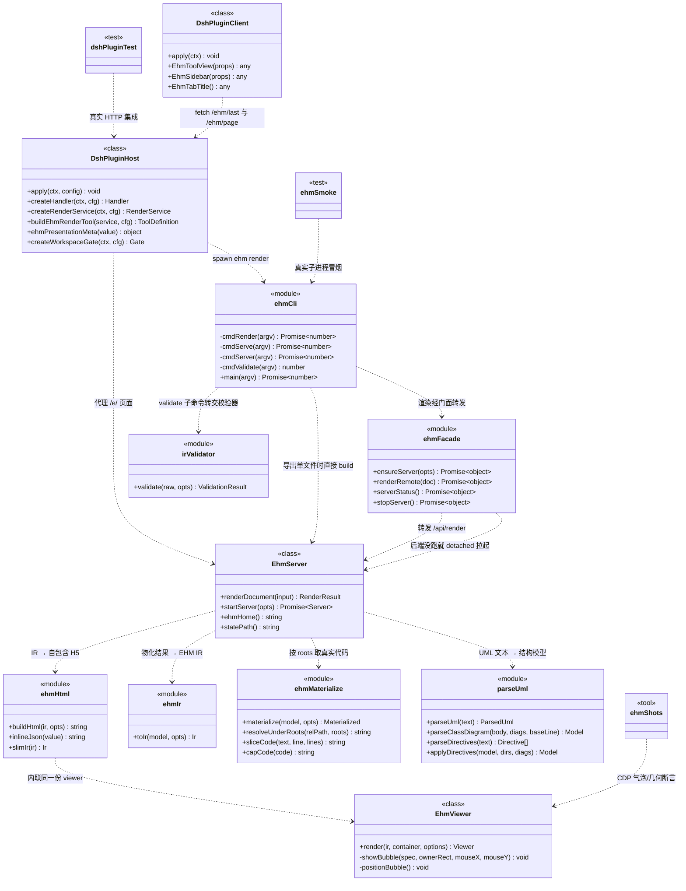

# enhance-mermaid 代码框架（自绘 · P13 合规样板）

> 这张图用 ehm 自身渲染：结构来源是下面的 mermaid `classDiagram`，`%% ehm:v1` 指令块只补
> file/line/lines/summary/sites；所有 file:line 均按本仓库真实源码核对（roots = 仓库根）。
> **P13 合规样板**：每个类/方法/字段都有完整代码范围（lines 覆盖声明/实现）、方法都带 summary
> （含义）、成员按真实代码标 UML 可见性（+ / - / # / ~），渲染后 `diagnostics` 为空。
> 14 个实体 / 16 条关系 / 16 个调用点。

%% ehm:v1
%% ── 实体位置（file 相对 --root=仓库根，line 1-based；lines 覆盖完整声明/关键实现）──
%% entity ehmCli file=enhance-mermaid/poc/bin/ehm.mjs line=483 lines=17 summary="单文件 CLI：render/serve/server/validate/skill 子命令与统一退出码"
%% entity ehmFacade file=enhance-mermaid/poc/src/facade.mjs line=54 lines=30 summary="薄门面：找后端、没跑就 detached 拉起、转发渲染请求"
%% entity parseUml file=enhance-mermaid/poc/src/parse-uml.mjs line=497 lines=25 summary="解析 mermaid classDiagram + %% ehm 指令，产出结构模型"
%% entity ehmMaterialize file=enhance-mermaid/poc/src/materialize.mjs line=209 lines=133 summary="按 roots 解析源码路径、切真实代码、产出证据与（P13）范围/含义/可见性约束诊断"
%% entity ehmIr file=enhance-mermaid/poc/src/to-ir.mjs line=138 lines=67 summary="把物化模型投影成 EHM IR 1.0.0（节点/关系/站点/member.summary）"
%% entity ehmHtml file=enhance-mermaid/poc/src/html.mjs line=150 lines=83 summary="把 IR + viewer + dagre + CSS 内联成一份自包含 H5"
%% entity EhmServer file=enhance-mermaid/poc/src/server.mjs line=68 lines=20 summary="纯函数 renderDocument 与 HTTP 后端：快照 LRU、/e/<id>、/stale"
%% entity EhmViewer file=enhance-mermaid/poc/viewer/ehm-viewer.js line=2799 lines=34 summary="交互式 viewer：dagre 布局、卡片、悬停气泡（含方法含义行）、跳转"
%% entity irValidator file=enhance-mermaid/spec/validate.mjs line=576 lines=47 summary="EHM IR 校验器：schema/引用/证据/视图/预算规则，CLI validate 直接复用"
%% entity DshPluginHost file=dsh-ehm/lib/index.js line=1357 lines=68 summary="DSH Host 半：/ehm/* 路由、同源页面代理、jump relay、ehm_render 工具、workspace 门禁"
%% entity DshPluginClient file=dsh-ehm/lib/client.js line=1459 lines=54 summary="DSH Client 半：内联 toolview、ehm fence 渲染、右栏 EHM tab、jump 桥"
%% entity ehmSmoke file=enhance-mermaid/poc/test/ehm.smoke.mjs line=43 lines=11 summary="端到端断言：真实子进程跑 CLI/server/HTML/IR（含 P13 约束诊断）"
%% entity dshPluginTest file=dsh-ehm/test/run.mjs line=55 lines=10 summary="零依赖断言：契约 + Client vm + Host 真实集成"
%% entity ehmShots file=enhance-mermaid/poc/tools/shots.mjs line=45 lines=32 summary="headless Chrome 截图 + 气泡/几何硬断言（视觉验收）"

%% ── 成员证据与含义（summary 会显示在悬停气泡头部）──
%% member ehmCli.cmdRender file=enhance-mermaid/poc/bin/ehm.mjs line=277 lines=69 summary="解析参数并转发渲染请求；--out 时导出单文件；strict 失败 exit 1"
%% member ehmCli.cmdServe file=enhance-mermaid/poc/bin/ehm.mjs line=347 lines=16 summary="前台运行后端，直到 Ctrl+C/SIGTERM"
%% member ehmCli.cmdServer file=enhance-mermaid/poc/bin/ehm.mjs line=364 lines=59 summary="server status/stop 子命令；--json 输出机器可读状态"
%% member ehmCli.cmdValidate file=enhance-mermaid/poc/bin/ehm.mjs line=428 lines=29 summary="把 IR 校验转交 spec/validate.mjs，退出码 0/1/2 原样透传"
%% member ehmCli.main file=enhance-mermaid/poc/bin/ehm.mjs line=483 lines=17 summary="分发子命令；未知命令打印帮助并 exit 2"
%% member ehmFacade.ensureServer file=enhance-mermaid/poc/src/facade.mjs line=54 lines=30 summary="读状态文件并做健康检查；没有后端就 detached 拉起"
%% member ehmFacade.renderRemote file=enhance-mermaid/poc/src/facade.mjs line=90 lines=20 summary="POST /api/render 转发渲染请求（可透传 strict）"
%% member ehmFacade.serverStatus file=enhance-mermaid/poc/src/facade.mjs line=112 lines=6 summary="只查询后端状态，不拉起后端"
%% member ehmFacade.stopServer file=enhance-mermaid/poc/src/facade.mjs line=120 lines=12 summary="调用 /api/shutdown 让后端退出"
%% member parseUml.parseUml file=enhance-mermaid/poc/src/parse-uml.mjs line=497 lines=25 summary="从整份文本解析出模型与诊断（mermaid 块 + %% 指令）"
%% member parseUml.parseClassDiagram file=enhance-mermaid/poc/src/parse-uml.mjs line=259 lines=81 summary="解析 classDiagram 主体：类、成员、关系"
%% member parseUml.parseDirectives file=enhance-mermaid/poc/src/parse-uml.mjs line=361 lines=36 summary="收集 %% 指令行（entity/member/rel/site/file）"
%% member parseUml.applyDirectives file=enhance-mermaid/poc/src/parse-uml.mjs line=414 lines=68 summary="把指令合并进模型（file/line/lines/summary 等）"
%% member ehmMaterialize.materialize file=enhance-mermaid/poc/src/materialize.mjs line=209 lines=133 summary="遍历实体/关系，读真实源码、切证据、产出 P13 约束诊断"
%% member ehmMaterialize.resolveUnderRoots file=enhance-mermaid/poc/src/materialize.mjs line=76 lines=21 summary="相对路径按 roots 顺序解析成绝对路径（首个存在者胜）"
%% member ehmMaterialize.sliceCode file=enhance-mermaid/poc/src/materialize.mjs line=191 lines=8 summary="按 line/lines 或花括号配平从文件切出真实代码"
%% member ehmMaterialize.capCode file=enhance-mermaid/poc/src/materialize.mjs line=108 lines=13 summary="把超长代码截断到 schema 上限并加显式标记"
%% member ehmIr.toIr file=enhance-mermaid/poc/src/to-ir.mjs line=138 lines=67 summary="模型 → EHM IR（实体/关系/视图/fold 预算/member.summary）"
%% member ehmHtml.buildHtml file=enhance-mermaid/poc/src/html.mjs line=150 lines=83 summary="把 IR、viewer、dagre、CSS 内联成自包含 H5"
%% member ehmHtml.inlineJson file=enhance-mermaid/poc/src/html.mjs line=33 lines=7 summary="把对象安全地内联成 script 标签里的 JSON 字面量"
%% member ehmHtml.slimIr file=enhance-mermaid/poc/src/html.mjs line=235 lines=19 summary="剥掉代码正文，得到适合内联传输的瘦 IR"
%% member EhmServer.renderDocument file=enhance-mermaid/poc/src/server.mjs line=68 lines=20 summary="纯函数：UML + roots → {ir, html, diagnostics}（strict 透传）"
%% member EhmServer.startServer file=enhance-mermaid/poc/src/server.mjs line=123 lines=245 summary="启动 HTTP 后端：渲染、快照 LRU、页面代理、jump 转发"
%% member EhmServer.ehmHome file=enhance-mermaid/poc/src/server.mjs line=47 lines=3 summary="状态目录：EHM_HOME 或 ~/.ehm"
%% member EhmServer.statePath file=enhance-mermaid/poc/src/server.mjs line=51 lines=3 summary="server.json 路径（记录端口/pid）"
%% member EhmViewer.render file=enhance-mermaid/poc/viewer/ehm-viewer.js line=2799 lines=3 summary="把 IR 渲染成可交互卡片图（公共 API，唯一渲染实现）"
%% member EhmViewer.showBubble file=enhance-mermaid/poc/viewer/ehm-viewer.js line=1909 lines=41 summary="按触发元素/鼠标坐标展示代码气泡（头部显示方法含义）"
%% member EhmViewer.positionBubble file=enhance-mermaid/poc/viewer/ehm-viewer.js line=2004 lines=96 summary="气泡定位：贴近鼠标且绝不遮挡 owner 元素"
%% member irValidator.validate file=enhance-mermaid/spec/validate.mjs line=576 lines=47 summary="校验 EHM IR：schema + 引用/证据/视图/预算规则"
%% member DshPluginHost.apply file=dsh-ehm/lib/index.js line=1357 lines=68 summary="注册 /ehm/* 路由、同源页面代理、jump relay 与 ehm_render 工具"
%% member DshPluginHost.createHandler file=dsh-ehm/lib/index.js line=1180 lines=108 summary="构造 /ehm/* HTTP handler 并挂到 webServer"
%% member DshPluginHost.createRenderService file=dsh-ehm/lib/index.js line=658 lines=348 summary="渲染服务：roots 门禁、spawn ehm CLI、缓存最近结果"
%% member DshPluginHost.buildEhmRenderTool file=dsh-ehm/lib/index.js line=1087 lines=81 summary="构造 Agent 工具 ehm_render（presentationMeta + ehm fence）"
%% member DshPluginHost.ehmPresentationMeta file=dsh-ehm/lib/index.js line=1029 lines=23 summary="把渲染结果投影成对话内联工具的 block.meta"
%% member DshPluginHost.createWorkspaceGate file=dsh-ehm/lib/index.js line=247 lines=56 summary="限定 roots 在工作区内，拒绝越界路径"
%% member DshPluginClient.apply file=dsh-ehm/lib/client.js line=1459 lines=54 summary="注册内联 toolview、ehm fence 渲染器与右侧栏 EHM tab"
%% member DshPluginClient.EhmToolView file=dsh-ehm/lib/client.js line=996 lines=56 summary="对话内联工具卡：一行状态（标题 + stats），无多余按钮"
%% member DshPluginClient.EhmSidebar file=dsh-ehm/lib/client.js line=715 lines=140 summary="右栏 EHM tab 的 iframe 内容"
%% member DshPluginClient.EhmTabTitle file=dsh-ehm/lib/client.js line=862 lines=20 summary="右栏 tab chip 标题（可见文本 EHM）"

%% ── 关系证据（line 指"这行代码促成了这条关系"）──
%% rel ehmCli>ehmFacade file=enhance-mermaid/poc/bin/ehm.mjs line=287
%% rel ehmCli>EhmServer file=enhance-mermaid/poc/bin/ehm.mjs line=312
%% rel ehmFacade>EhmServer file=enhance-mermaid/poc/src/facade.mjs line=65
%% rel ehmFacade>EhmServer#2 file=enhance-mermaid/poc/src/facade.mjs line=101
%% rel EhmServer>parseUml file=enhance-mermaid/poc/src/server.mjs line=22
%% rel EhmServer>ehmMaterialize file=enhance-mermaid/poc/src/server.mjs line=23
%% rel EhmServer>ehmIr file=enhance-mermaid/poc/src/server.mjs line=24
%% rel EhmServer>ehmHtml file=enhance-mermaid/poc/src/server.mjs line=25
%% rel ehmHtml>EhmViewer file=enhance-mermaid/poc/src/html.mjs line=17
%% rel ehmCli>irValidator file=enhance-mermaid/poc/bin/ehm.mjs line=443
%% rel DshPluginHost>ehmCli file=dsh-ehm/lib/index.js line=580
%% rel DshPluginHost>EhmServer file=dsh-ehm/lib/index.js line=968
%% rel DshPluginClient>DshPluginHost file=dsh-ehm/lib/client.js line=513
%% rel ehmSmoke>ehmCli file=enhance-mermaid/poc/test/ehm.smoke.mjs line=419
%% rel dshPluginTest>DshPluginHost file=dsh-ehm/test/run.mjs line=86
%% rel ehmShots>EhmViewer file=enhance-mermaid/poc/tools/shots.mjs line=218

%% ── 调用点（同一对端点多条关系用 From>To#n 指向第 n 条）──
%% site ehmCli>ehmFacade file=enhance-mermaid/poc/bin/ehm.mjs line=287 column=34
%% site ehmCli>EhmServer file=enhance-mermaid/poc/bin/ehm.mjs line=312 column=38
%% site ehmFacade>EhmServer file=enhance-mermaid/poc/src/facade.mjs line=65 column=17
%% site ehmFacade>EhmServer#2 file=enhance-mermaid/poc/src/facade.mjs line=101 column=19
%% site EhmServer>parseUml file=enhance-mermaid/poc/src/server.mjs line=22 column=1
%% site EhmServer>ehmMaterialize file=enhance-mermaid/poc/src/server.mjs line=23 column=1
%% site EhmServer>ehmIr file=enhance-mermaid/poc/src/server.mjs line=24 column=1
%% site EhmServer>ehmHtml file=enhance-mermaid/poc/src/server.mjs line=25 column=1
%% site ehmHtml>EhmViewer file=enhance-mermaid/poc/src/html.mjs line=17 column=23
%% site ehmCli>irValidator file=enhance-mermaid/poc/bin/ehm.mjs line=443 column=13
%% site DshPluginHost>ehmCli file=dsh-ehm/lib/index.js line=580 column=17
%% site DshPluginHost>EhmServer file=dsh-ehm/lib/index.js line=968 column=26
%% site DshPluginClient>DshPluginHost file=dsh-ehm/lib/client.js line=515 column=24
%% site ehmSmoke>ehmCli file=enhance-mermaid/poc/test/ehm.smoke.mjs line=419 column=13
%% site dshPluginTest>DshPluginHost file=dsh-ehm/test/run.mjs line=86 column=22
%% site ehmShots>EhmViewer file=enhance-mermaid/poc/tools/shots.mjs line=218 column=30
