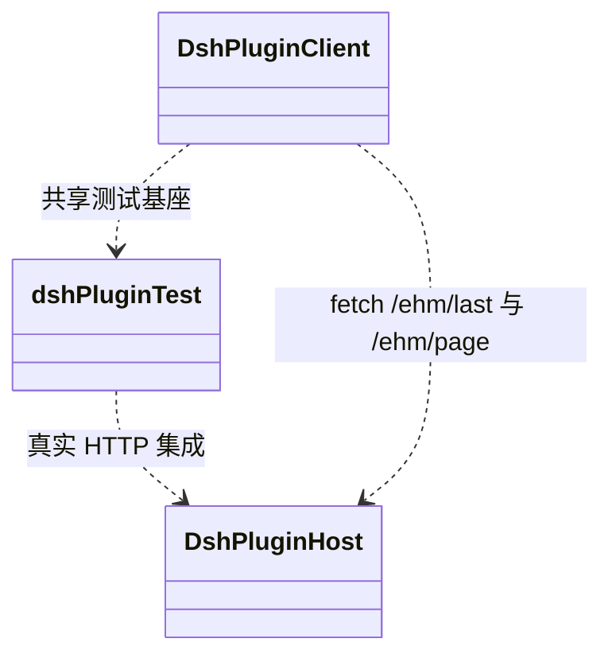

# route-overlap fixture（小用例：3 条边共享目标卡，验证真实相交/重叠）

%% entity dshPluginTest file=plugin/README.md line=1 lines=2 summary="真实 HTTP 集成测试入口"
%% entity DshPluginClient file=plugin/README.md line=3 lines=2 summary="浏览器侧 Client 半"
%% entity DshPluginHost file=plugin/README.md line=5 lines=2 summary="DSH 宿主侧 Host 半"
