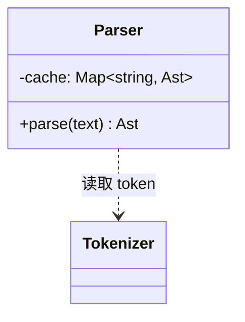
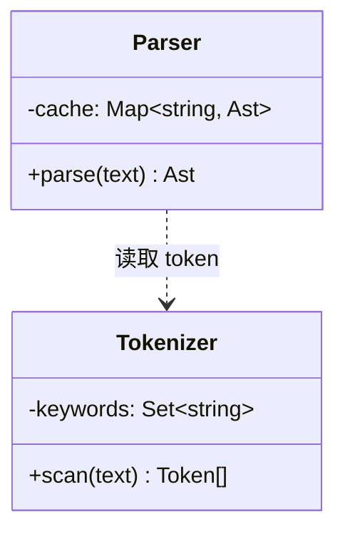

# EHM 增强 UML 作者指南（AI 专用）

> 目标：让 AI 写出的 EHM UML **可信**——图上的每个类/方法/字段都能对回真实代码，
> 每个方法都有含义说明，可见性符合 UML 语法与真实代码（不是一律 `+`）。
> 校验靠 `ehm render` 的 `diagnostics`（机器可读），本技能就是"怎么一次写对"。

## 1. 什么时候用

- 用户要"画代码结构图 / 架构图 / 类图 / 调用关系图"，且希望点击能跳回真实源码。
- 用户要解释某个模块的实现结构，需要图 + 真实代码证据。
- 需要把一张图作为回答的主要输出（DSH 里由 `ehm_render` 渲染）。

不适用：流程图/时序图（ehm 只支持 mermaid `classDiagram` 的结构）。

## 2. 权威事实

| 事实 | 来源 |
| --- | --- |
| 语法 = mermaid `classDiagram` + `%% ehm:v1` 指令块 | `poc/src/parse-uml.mjs` |
| 证据 = `file`（相对某个 `--root`）+ `line`（1-based）+ 可选 `lines` / `column` | `poc/src/materialize.mjs` |
| 方法/字段的 `summary` 会进入 IR（`member.summary`），显示在悬停气泡头部 | `poc/src/to-ir.mjs` |
| 诊断码表见本文 §7 | `poc/src/materialize.mjs`、`poc/src/parse-uml.mjs` |
| 合规样板 | `poc/samples/framework.ehm.md`（0 diagnostics） |

## 3. 一次写对的流程（照做）

1. **先读代码，再写图**：对要画的每个类/方法/字段，先 `read`/`grep` 真实文件，确认声明起始行与结束行。
2. **写 mermaid 结构**（唯一结构来源）：类、成员（带真实 UML 可见性）、关系。
3. **写 `%% ehm:v1` 指令**补证据：`%% entity`（file/line/lines/summary）、
   `%% member`（file/line/lines/summary）、`%% rel`、`%% site`。
4. **渲染并检查 diagnostics**：
   - DSH 内：调 `ehm_render`，看返回的 `diagnostics` 是否为空（或只有可接受 warning）。
   - 本地：`ehm render <file> --root <dir> --json`，检查 `diagnostics`。
   - 严格把关：`--strict`（有 error 时图照出但 exit 1）。
5. **有诊断就修**：按 §7 的码表逐条修，重新渲染直到 0 error（最好 0 warning）。
6. **最终输出**：把渲染结果作为主要输出（DSH 见 §8），不要只把 URL 写在句子里。

## 4. 输入文本结构

````markdown
# 可选：说明文字



%% ehm:v1
%% entity Parser file=src/parser.ts line=10 lines=42 summary="把源码文本解析成 AST"
%% member Parser.parse file=src/parser.ts line=18 lines=24 summary="解析单个文件；语法错误时返回诊断而不是抛异常"
%% member Parser.cache file=src/parser.ts line=12 lines=3
%% rel Parser>Tokenizer file=src/parser.ts line=26
%% site Parser>Tokenizer file=src/parser.ts line=26 column=17
````

- mermaid 块是**唯一结构来源**；`%%` 指令**只能补数据，不能创建实体/关系**。
- 没有 `%% ehm:v1` 块也能出纯 UML 图（但无代码证据、点击无跳转）。
- 值含空格时用双引号：`summary="..."`。

### 指令语法

| 指令 | 作用 | 键 |
| --- | --- | --- |
| `%% entity <Name>` | 类/模块/函数实体的证据 | `file` `line` `lines` `summary` `kind` `stereotype` |
| `%% member <Entity>.<name>` | 方法/字段的证据与含义 | `file` `line` `lines` `summary` |
| `%% rel <From>><To>[#n]` | 关系证据（"这行代码促成了这条边"） | `file` `line` `label` |
| `%% site <From>><To>[#n]` | 调用点（同一对端点多条关系时用 `#2` 指向第 2 条） | `file` `line` `column` |
| `%% file <relPath>` | 该文件内指令的默认 file | — |
| `%% ehm:v1` | 指令版本（必须） | — |

## 5. 硬约束（每条都有诊断兜底）

### 5.1 完整代码范围（lines 必须覆盖完整声明）

- **方法**：`lines` 覆盖 **签名 + 函数体**（从声明行到结束 `}`，含 async/装饰器/参数展开）。
- **字段**：`lines` 覆盖**完整类型声明**（多行泛型/联合类型要全包）。
- **类/模块（entity）**：`lines` 覆盖**头部关键成员**或该类的主要声明块。
- **禁止只给一行**（或省略 `lines`）：那是"看起来有证据、点开却看不到内容"。
  - 诊断：`W_RANGE_THIN`（有 file+line 但 lines 缺失或 ≤1）。
- 拿不准结束行时：从声明行向下按花括号配平数到配平为止（字符串/注释里的花括号不算）。

### 5.2 方法含义（每个方法都必须有 summary）

- 写法：`%% member Foo.bar file=... line=... lines=N summary="一句话说明这个方法做什么 / 为什么存在"`
- 一句话，**不超过 200 字符**；写"行为 + 目的"，不要抄签名（签名已在图上）。
- 缺失：`W_MEMBER_NO_SUMMARY`。类（`%% entity`）和字段建议也给 summary（不强制，但强烈建议）。
- 示例：
  - ✅ `summary="把当前会话压缩成摘要；超过预算时才触发"`
  - ❌ `summary="compact"`（等于没说）

### 5.3 真实 UML 可见性（不要一律 +）

mermaid 成员行的第一个字符就是 UML 可见性，必须按真实代码写：

| 前缀 | UML 含义 | 典型来源 |
| --- | --- | --- |
| `+` | public | 导出的函数/类、TS `public`、对外 API |
| `-` | private | TS `private`、`#field`、模块内未导出的常量/函数 |
| `#` | protected | TS `protected` |
| `~` | package | 同包可见（JS 模块内约定 / 目录内共享） |

- 写法：`+parse(text) Ast`、`-cache: Map~string, Ast~`、`#onClose() void`。
- 缺失：`W_VISIBILITY_DEFAULT`（成员没写 `+ - # ~`）。
- 判断规则：**先看真实源码有没有 `export` / `private` / `protected` / `#`，再决定前缀**；
  同一模块里既有公开 API 也有内部函数时，内部函数用 `-`。

### 5.4 file:line 必须逐行核对

- 先读文件确认行号（`read` 带 offset 或 `grep -n`），**禁止估算**；相对路径以 `--root`/`roots` 为基准。
- `--root` 必须覆盖**所有**证据文件；跨仓库/多根要传多个 `--root`（按解析顺序，首个命中胜）。
- 诊断：`E_PATH`（文件不存在 / 路径非法）、`E_LINE`（行号越界）、`E_READ`（读失败）。
- 只接受相对路径：拒绝绝对路径与 `..` 越界。

### 5.5 关系与调用点也要证据

- 每条 `classDiagram` 关系都要 `%% rel`（文件 + 促成这行关系真实代码的 `line`）。
- 多调用点用 `%% site`（另带 `column`）；同一对端点多条边用 `From>To#2` 区分。
- 诊断：`W_NO_LINE`（关系没 line）、`W_UNKNOWN_REL`（指令指向不存在的边）。

### 5.6 关系标签避免 `--` 等箭头片段

- 解析器会把标签里的 `--`、`--|>`、`..>` 之类片段误判成边；
  例如标签写 `--out` 会破坏解析。
- 用中文/无箭头词：`输出文件`、`读取 token`、`继承自 Service`；不要写 `--out`、`-->`。

### 5.7 roots 覆盖证据文件

- DSH 内 `ehm_render` 的 `roots` 默认取插件配置 / 会话工作区；跨目录证据要显式传 `roots`。
- CLI：`--root` 可重复，按顺序解析，**首个命中者胜**；两个 root 同时命中会报 `W_AMBIGUOUS`
  （`--strict` 升级为 `E_AMBIGUOUS`）。

### 5.8 渲染后看诊断

- `diagnostics` 有 `error` → 必须修；有 `warning` → 建议修。
- `--strict`：有 error 时仍产出图/URL，但进程 exit 1（用于 CI/Agent 自检）。
- 非 strict：warning 不阻断（部分成功也 exit 0），但这不表示图是好的——**要主动读 diagnostics**。

## 6. 完整合规示例



%% ehm:v1
%% entity Parser file=src/parser.ts line=10 lines=42 summary="把源码文本解析成 AST"
%% entity Tokenizer file=src/tokenizer.ts line=6 lines=31 summary="把源码切成 token 序列"
%% member Parser.parse file=src/parser.ts line=18 lines=24 summary="解析单个文件；语法错误时返回诊断而不是抛异常"
%% member Parser.cache file=src/parser.ts line=12 lines=3
%% member Tokenizer.scan file=src/tokenizer.ts line=14 lines=18 summary="扫描整个输入，返回 token 数组"
%% member Tokenizer.keywords file=src/tokenizer.ts line=8 lines=2
%% rel Parser>Tokenizer file=src/parser.ts line=26
%% site Parser>Tokenizer file=src/parser.ts line=26 column=17

→ 渲染后 `diagnostics` 应为 `[]`（0 error / 0 warning）。

## 7. 诊断码表与修复

| 码 | 级别 | 含义 | 怎么修 |
| --- | --- | --- | --- |
| `E_NO_UML` | error | 找不到 mermaid `classDiagram` 块 | 加 ` ```mermaid ... ``` ` 块 |
| `E_EHM_VERSION` | error | `%% ehm:vX` 版本不支持 | 写成 `%% ehm:v1` |
| `E_PATH` | error | 文件不在任何 root 下 / 路径非法 | 核对相对路径与 `--root`；禁止绝对路径、`..` |
| `E_LINE` | error | line 超出文件行数 | 重新核对真实行号（改代码后行号会漂） |
| `E_READ` | error | 文件读不了 | 检查权限/编码/路径 |
| `W_AMBIGUOUS` / `E_AMBIGUOUS` | warn / error | 多个 root 命中同一相对路径（strict 升级为 error） | 去掉多余 root 或用唯一路径 |
| `W_NO_EHM_BLOCK` | warn | 没有 `%% ehm:v1` 指令块 | 补指令块（否则无证据/无跳转） |
| `W_UNKNOWN_DIRECTIVE` / `W_UNKNOWN_KEY` | warn | 未知指令/参数（笔误） | 按 §4 语法改正 |
| `W_UNKNOWN_ENTITY` / `W_UNKNOWN_MEMBER` / `W_UNKNOWN_REL` | warn | 指令指向 mermaid 里不存在的实体/成员/边 | 先声明结构，再写指令 |
| `W_SKIP_STATEMENT` | warn | 不支持的 mermaid 语句 | 简化为 `classDiagram` 支持的写法 |
| `W_RANGE_THIN` | warn | 有 file+line 但 lines 缺失/≤1（只给一行） | 按 §5.1 用 lines 给完整范围 |
| `W_MEMBER_NO_SUMMARY` | warn | 方法有证据但缺 summary | 补 `summary="一句话含义"` |
| `W_VISIBILITY_DEFAULT` | warn | 成员没写 UML 可见性 | 按 §5.3 补 `+ - # ~` |
| `W_MEMBER_NO_LINE` | warn | 有成员没标 line（汇总一条） | 给关键成员补 `%% member ... line=...` |
| `W_NO_LINE` | warn | 关系没 line | 补 `%% rel ... line=...` |
| `W_UNBALANCED` | warn | 没给 lines 且花括号没配平 | 显式给 `lines`，或核对代码块范围 |

## 8. DSH 内联渲染流程（主要输出）

在 DSH 会话里，用宿主提供的 `ehm_render` 工具（不要自己起服务）：

1. 调 `ehm_render({ file, roots, title, scope, theme })` 或 `ehm_render({ uml, roots, title })`。
2. 成功后工具结果里会带一个 `fence` 字段（形如）：

   ````markdown
   ```ehm
   {"ehm":1,"id":"f2857a250bd5","url":"http://127.0.0.1:8001/e/f2857a250bd5","title":"...","stats":{"entities":14,"relations":16,"sites":16}}
   ```
   ````

3. **最终回答里把这个 fence 原样粘贴进正文作为主要输出**（不要改写、不要只贴 URL）。`"ehm":1` 是渲染器的正文自证标记（DSH 对未知语言不显示语言标签），必须保留。
   DSH 的 ehm fence 渲染器会在正文里把它渲染成大幅内联结构图。
4. 若工具返回 `ok:false`：先按 `error`/`hint` 修输入（通常是路径/行号/roots），再重试。
5. 工具结果里的 `diagnostics` 必须检查；有 error 就不要把图当最终输出。

## 9. CLI 校验命令

```bash
# 渲染 + 看诊断（--json 里 diagnostics 数组）
ehm render poc/samples/framework.ehm.md --root . --json

# 严格模式：有任何 error 诊断 → exit 1（图/URL 仍会产出）
ehm render <file> --root <dir> --strict --json

# 纯 UML 文本从 stdin 进
printf '...' | ehm render - --root . --json

# 校验一份 EHM IR（管道/文件/自测）
ehm validate spec/sample.ir.json
curl -s http://127.0.0.1:<port>/e/<id>.json | ehm validate -
ehm validate --selftest

# 本技能原文 / 机器可读
ehm skill
ehm skill --json
```

### 9.1 布局方向（默认纵向）

- **默认 `--direction tb`**：自上而下（纵向为主），适合右侧栏 / 纵向内联会话；侧边栏窄时优先用它。
- `--direction lr`：从左到右（横向为主），适合宽屏、横向内联或分享单文件。
- `--direction horizontal` / `vertical` 是 `lr` / `tb` 的别名；`ehm_render` 工具传 `direction: "tb" | "lr"`。
- 方向是**渲染时**决定的（写进 H5 的 `__EHM_META__.direction`），同一份 UML 可以分别出纵向/横向两个快照。

## 10. 常见错误清单（提交前自检）

- [ ] 有没有成员只给了一行 / 没给 `lines`？→ `W_RANGE_THIN`
- [ ] 每个方法都有 `summary="..."` 吗？→ `W_MEMBER_NO_SUMMARY`
- [ ] 成员前缀都是按真实代码标的 `+ - # ~` 吗（不是一律 `+`）？→ `W_VISIBILITY_DEFAULT`
- [ ] 所有 `file:line` 都对着真实文件核对过（不是猜的）吗？
- [ ] `--root` / `roots` 是否覆盖了全部证据文件？
- [ ] 每条关系都有 `%% rel`、每个调用点都有 `%% site` 吗？
- [ ] 关系标签里有没有 `--` 之类的箭头片段（如 `--out`）？
- [ ] 渲染后 `diagnostics` 是否 0 error（最好 0 warning）？
- [ ] 最终回答是否把图（ehm fence）作为主要输出，而不是只给链接？

